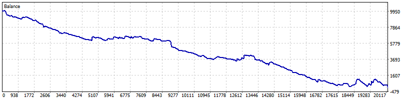
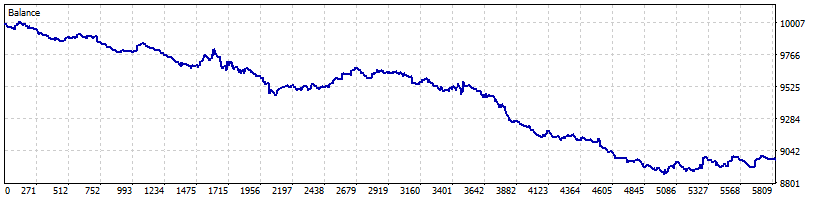

# Uji Strategi Parabolic SAR (SAR_Trend_M5)

Tanggal uji: 1 November 2026
Terminal: MetaTrader 5 build 6296, akun demo MetaQuotes-Demo 10013410590
Alat uji: Strategy Tester bawaan MT5, dijalankan headless lewat file `.ini`

## 1. Ringkasan

Strategi Parabolic SAR pada M5 tidak punya edge yang cukup untuk menutup biaya transaksi, dan EA aslinya punya bug eksekusi yang jauh lebih berbahaya: posisi ditumpuk pada setiap tick selama sinyal masih berlaku.

Dua angka yang paling penting:

- EA asli, XAUUSD M5 sepanjang 2024: 20.113 trade, saldo 10.000 USD habis menjadi 22,39 USD (-99,78%), 2.155 order ditolak karena dana tidak cukup.
- Varian kontrol (satu posisi, sinyal di bar tertutup), XAUUSD M5 2024: 5.803 trade, -1.025,91 USD (-10,26%), profit factor 0,88. Pada 2023 juga negatif (-4,77%, PF 0,92). EURUSD 2024: -3,08%, PF 0,83.

Artinya: setelah bug eksekusi diperbaiki pun, sinyal balik arah SAR di M5 tetap merugi. Kerugiannya konsisten di dua simbol dan dua tahun, jadi ini bukan kebetulan satu periode.

## 2. Yang diuji

Ada dua salinan EA di folder terminal:

- `MQL5\parabolic.mq5` (lot 0,1, filling IOC), file yang dilampirkan.
- `MQL5\Experts\SAR_Trend_M5.mq5` (lot 0,01, filling FOK).

Logikanya sama. Strategy Tester hanya bisa menjalankan EA yang ada di `MQL5\Experts`, jadi yang diuji adalah `SAR_Trend_M5` (versi lot 0,01). Hasilnya berlaku untuk logika yang sama di `parabolic.mq5`, dengan catatan lot 0,1 akan mempercepat kerugian 10 kali lipat.

## 3. Metode

| Parameter | Nilai |
|---|---|
| Simbol dan timeframe | XAUUSD M5, EURUSD M5 |
| Periode | 2023.01.01 sampai 2024.12.31 (per tahun) |
| Model | M1 OHLC (bukan real tick) |
| Deposit awal | 10.000 USD |
| Leverage | 1:100 |
| Lot | 0,01 |
| Parameter SAR | Step 0,02, Maximum 0,2 (default) |
| Spread | Bawaan akun demo MetaQuotes |

Varian kontrol dibuat khusus untuk pengujian, terpisah dari file asli:
`MQL5\Experts\SAR_Trend_M5_Control.mq5`. Isinya sama, dengan dua perbaikan minimal:

1. Sinyal dihitung dari bar yang sudah tertutup (SAR bar 1 dan 2), bukan dari bar yang sedang berjalan.
2. Maksimal satu posisi per simbol, tidak menambah posisi searah.

Kontrol ini memisahkan kualitas sinyal dari bug eksekusi. Tanpa kontrol, hasil uji hanya mengukur kerusakan bug, bukan strateginya.

## 4. Hasil

### 4.1 EA asli (apa adanya)

| Simbol | Periode | Trade | Net profit | Profit factor | Win rate | Max drawdown |
|---|---|---:|---:|---:|---:|---:|
| XAUUSD M5 | 2024 | 20.113 | -9.977,61 (-99,78%) | 0,65 | 28,77% | 99,78% |
| EURUSD M5 | 2024 | 75.491 | -8.107,99 (-81,64%) | 0,68 | 31,23% | 81,64% |
| XAUUSD M5 | Jun 2024 | 5.460 | +350,75 (+3,51%) | 1,05 | 35,86% | 13,99% |

Contoh eksekusi nyata dari laporan EURUSD: 7 order beli terbuka pada detik yang sama (2024.01.02 02:46:40), lalu order baru setiap sekitar 20 detik selama sinyal masih berlaku. Pada XAUUSD, 2.155 order ditolak dengan kode 10018 (dana tidak cukup), dan tes berakhir di saldo 22,39 USD.

Satu bulan Juni 2024 terlihat profit, tetapi setahun penuh menghabiskan akun. Ini contoh klasik kenapa uji satu bulan tidak cukup.



### 4.2 Varian kontrol (satu posisi, sinyal bar tertutup)

| Simbol | Periode | Trade | Net profit | Profit factor | Win rate | Max drawdown | Rata-rata tahan |
|---|---|---:|---:|---:|---:|---:|---:|
| XAUUSD M5 | 2024 | 5.803 | -1.025,91 (-10,26%) | 0,88 | 35,14% | 11,58% | 1:04:30 |
| XAUUSD M5 | 2023 | 5.697 | -477,01 (-4,77%) | 0,92 | - | 6,60% | 1:05:27 |
| EURUSD M5 | 2024 | 6.212 | -308,48 (-3,08%) | 0,83 | 34,61% | 3,16% | 1:00:15 |



### 4.3 Matematika expectancy

XAUUSD kontrol 2024:

- Rata-rata profit 3,81 USD, rata-rata loss 2,34 USD, rasio 1,63.
- Win rate aktual 35,14%. Dengan rasio 1,63, win rate impas adalah 38,0%.
- Expectancy: (0,3514 x 3,81) - (0,6486 x 2,34) = -0,18 USD per trade.

EURUSD kontrol 2024:

- Rata-rata profit 0,69 USD, rata-rata loss 0,44 USD, rasio 1,57.
- Win rate aktual 34,61%, win rate impas 38,9%.
- Expectancy: -0,05 USD per trade.

Polanya sama di dua simbol: win rate kurang sekitar 3 sampai 4 poin persentase dari titik impas. Dengan 5.800 sampai 6.200 trade per tahun, defisit kecil per trade berubah menjadi kerugian besar setahun.

## 5. Temuan pada kode

Nomor baris mengacu ke `MQL5\parabolic.mq5`.

1. **Position stacking (baris 76 sampai 87).** `OpenTrade()` dipanggil setiap tick selama kondisi benar, tanpa cek apakah sudah ada posisi searah. Di akun hedging, setiap tick membuka posisi baru. Ini penyebab 20.113 dan 75.491 trade, 2.155 penolakan karena dana habis, dan saldo akhir 22,39 USD. Ini bug paling merusak.
2. **Sinyal dihitung di bar yang sedang berjalan (baris 55, 76, 84).** `CopyBuffer` mengambil indeks 0 dan membandingkannya dengan `iLow(...,0)` / `iHigh(...,0)`. Nilai SAR bar berjalan berubah setiap tick, jadi sinyal bisa muncul dan hilang dalam satu bar. Entry jadi bergantung pada tick mana yang kebetulan datang lebih dulu.
3. **`PositionSelectByMagic` tidak memfilter simbol (baris 66 dan 146).** Semua posisi dengan magic yang sama dianggap milik chart ini. Kalau EA dipasang di beberapa simbol dengan magic sama, status buy/sell jadi salah dan posisi simbol lain ikut ditutup.
4. **`ClosePosition` menutup semua posisi dengan magic itu (baris 115).** Sama seperti di atas, tidak ada filter `POSITION_SYMBOL`.
5. **Hasil order tidak diperiksa dengan benar (baris 108 dan 136).** Kode hanya mencetak log kalau `OrderSend()` mengembalikan false. Penolakan server yang tetap mengembalikan true tetapi `retcode` bukan `TRADE_RETCODE_DONE` tidak tercatat, jadi EA bisa terlihat berjalan padahal order ditolak.
6. **Filling mode tidak konsisten.** `parabolic.mq5` memakai `ORDER_FILLING_IOC` (baris 106 dan 134), sedangkan salinan di `Experts` memakai FOK. Sebagian broker hanya menerima salah satunya, dan order akan ditolak tanpa penjelasan di log.
7. **Tidak ada kontrol risiko.** Tidak ada SL/TP, filter spread, validasi lot terhadap margin, atau cek `TerminalInfoInteger(TERMINAL_TRADE_ALLOWED)`. Lot default 0,1 di `parabolic.mq5` adalah 10 kali lot yang diuji, jadi di akun 10.000 USD kerugiannya akan jauh lebih cepat.
8. **Dua salinan yang berbeda.** `MQL5\parabolic.mq5` dan `MQL5\Experts\SAR_Trend_M5.mq5` adalah sumber yang sama dengan parameter berbeda. Mudah salah edit dan salah compile. Sebaiknya satu file saja.
9. **Kode mati.** `priceClose` dan `priceOpen` (baris 59 dan 60) dihitung tetapi tidak dipakai.

## 6. Kesimpulan

- Sebagai EA, versi asli tidak layak dipakai sama sekali. Bukan karena strateginya, tetapi karena menumpuk posisi sampai akun habis.
- Sebagai strategi, Parabolic SAR flip di M5 juga belum layak. Varian kontrol masih negatif di XAUUSD 2023, XAUUSD 2024, dan EURUSD 2024.
- Penyebab utamanya bukan slippage ekstrem, tetapi frekuensi trade yang sangat tinggi dengan edge per trade di bawah biaya spread. Dengan sekitar 23 trade per hari, biaya transaksi menjadi faktor penentu.

## 7. Rekomendasi berurutan

1. Perbaiki eksekusi dulu: evaluasi hanya saat bar baru, satu posisi per simbol dan magic, filter posisi berdasarkan `POSITION_SYMBOL`, dan cek `result.retcode` setelah setiap `OrderSend`.
2. Jangan aktifkan ke akun riil sebelum lolos uji ulang dengan model real tick dan spread broker yang sebenarnya.
3. Kalau strategi mau dilanjutkan, uji timeframe lebih tinggi (H1 atau H4) dan tambahkan filter tren, karena SAR di M5 terlalu sering berbalik. Ukur juga win rate dan expectancy per filter, bukan hanya net profit.
4. Tambahkan SL/TP atau trailing stop, lalu uji sensitivitas parameter (Step 0,01 sampai 0,04 dan Maximum 0,1 sampai 0,4). Tanpa itu, parameter default belum terbukti apa pun.
5. Setelah ada versi yang positif di data 2023 dan 2024, baru lakukan walk-forward atau uji out-of-sample 2025.

## 8. Batasan uji

- Semua uji memakai model M1 OHLC, bukan real tick. EA asli sangat bergantung pada tick, jadi angka pastinya bisa berbeda di model real tick. Arah hasilnya tidak akan berubah: 2.155 penolakan "dana tidak cukup" sudah membuktikan akun habis karena penumpukan posisi.
- Spread dan komisi mengikuti akun demo MetaQuotes, bukan broker tempat EA akan dipakai.
- Tidak ada optimasi parameter. Semua uji memakai nilai default SAR 0,02 / 0,2.
- Hasil backtest bukan jaminan performa live.

## 9. EA versi perbaikan (Parabolic SAR Fix)

File: `MQL5\Experts\Parabolic SAR Fix.mq5`, sudah dikompilasi menjadi `Parabolic SAR Fix.ex5`.

Yang diperbaiki dari `parabolic.mq5`:

1. Sinyal hanya dievaluasi sekali per bar, memakai SAR bar 1 dan 2 yang sudah tertutup.
2. Maksimal satu posisi per simbol dan magic. Sinyal berlawanan menutup posisi lama dulu, baru membuka yang baru.
3. Semua pencarian dan penutupan posisi memfilter `POSITION_SYMBOL` dan magic.
4. Setiap `OrderSend` diperiksa lewat `retcode`, bukan hanya nilai balik fungsi.
5. Filling mode dipilih otomatis sesuai `SYMBOL_FILLING_MODE` broker (FOK, lalu IOC, lalu RETURN).
6. Volume dinormalisasi ke min, max, dan step broker. Parameter SAR divalidasi di `OnInit`.
7. Kode mati (`priceClose`, `priceOpen`) dihapus.

Hasil uji ulang, lot 0,01, periode dan model sama:

| Simbol | Periode | Trade | Net profit | Profit factor | Max drawdown |
|---|---|---:|---:|---:|---:|
| XAUUSD M5 | 2024 | 5.803 | -1.025,91 (-10,26%) | 0,88 | 11,58% |
| EURUSD M5 | 2024 | 6.212 | -308,48 (-3,08%) | 0,83 | 3,16% |

Angka ini identik dengan varian kontrol, jadi perbaikan eksekusi berhasil: tidak ada lagi penumpukan posisi, dan entry tidak lagi berubah antar tick.

Catatan: pengujian memakai lot 0,01. File final memakai default lot 0,1 seperti kode asli. Dengan lot 0,1, uji XAUUSD 2024 menghasilkan drawdown 97,63% dan saldo 241,84 USD, jadi lot 0,01 jauh lebih aman untuk akun 10.000 USD.

Kesimpulan tetap: eksekusinya sekarang benar, tetapi strateginya masih merugi. Jangan dipakai di akun riil tanpa filter tambahan.

## 10. Hasil per tahun (EA fix, lot 0,01)

Semua uji memakai model M1 OHLC, deposit 10.000 USD, parameter SAR default.

| Simbol | Tahun | Trade | Net profit | PF | Win rate | Max drawdown |
|---|---|---:|---:|---:|---:|---:|
| XAUUSD M5 | 2022 | 5.716 | -591,77 (-5,92%) | 0,91 | 36,02% | 6,42% |
| XAUUSD M5 | 2023 | 5.697 | -477,01 (-4,77%) | 0,92 | 35,67% | 6,60% |
| XAUUSD M5 | 2024 | 5.803 | -1.025,91 (-10,26%) | 0,88 | 35,14% | 11,58% |
| XAUUSD M5 | 2025 | 5.632 | +599,64 (+6,00%) | 1,04 | 38,49% | 3,38% |
| EURUSD M5 | 2023 | 6.186 | -424,40 (-4,24%) | 0,81 | 35,08% | 4,57% |
| EURUSD M5 | 2024 | 6.212 | -308,48 (-3,08%) | 0,83 | 34,61% | 3,16% |
| EURUSD M5 | 2025 | 6.364 | -724,90 (-7,25%) | 0,73 | 33,58% | 7,25% |

Total gabungan dengan saldo berjalan:

- XAUUSD 2022 sampai 2025: saldo 8.504,95 USD, -14,95%.
- EURUSD 2023 sampai 2025: saldo 8.542,22 USD, -14,58%.

Hanya XAUUSD 2025 yang positif. Itu pun tidak merata, lihat bagian bulanan.

## 11. Hasil per bulan

XAUUSD M5, laba bersih per bulan dalam USD:

| Bulan | 2022 | 2023 | 2024 | 2025 |
|---|---:|---:|---:|---:|
| Jan | -187,79 | +27,43 | -107,62 | -137,57 |
| Feb | +67,00 | -145,82 | -95,80 | +119,47 |
| Mar | -73,47 | +2,24 | -128,22 | +18,46 |
| Apr | -29,15 | -115,17 | -73,94 | -57,69 |
| May | -67,43 | +171,05 | -39,40 | +48,80 |
| Jun | +10,04 | -39,34 | +76,85 | +114,67 |
| Jul | -38,23 | -168,39 | -132,96 | +28,54 |
| Aug | -68,69 | -59,18 | -260,18 | -90,02 |
| Sep | -105,45 | -38,35 | -98,65 | -111,45 |
| Oct | +40,51 | -130,31 | -241,44 | +454,96 |
| Nov | -126,40 | -100,27 | +37,46 | +263,11 |
| Dec | -12,71 | +119,10 | +37,99 | -51,64 |

EURUSD M5, laba bersih per bulan dalam USD:

| Bulan | 2023 | 2024 | 2025 |
|---|---:|---:|---:|
| Jan | +7,78 | -35,17 | -67,75 |
| Feb | -87,45 | -55,80 | -46,15 |
| Mar | -88,37 | -10,58 | -40,18 |
| Apr | -21,24 | -21,97 | -80,69 |
| May | -29,00 | -22,91 | -75,36 |
| Jun | -26,38 | +10,28 | -66,74 |
| Jul | -39,64 | -27,32 | -101,45 |
| Aug | -31,37 | -13,98 | -70,32 |
| Sep | -42,15 | -1,24 | -63,54 |
| Oct | -28,72 | -50,77 | -59,90 |
| Nov | -23,98 | -5,98 | -11,21 |
| Dec | -13,88 | -73,04 | -41,61 |

Catatan bulanan:

- XAUUSD: 17 dari 48 bulan positif (35,4%). EURUSD: 2 dari 36 bulan positif (5,6%).
- XAUUSD 2025 terlihat positif, tetapi +454,96 pada Oktober dan +263,11 pada November menyumbang +718,07. Sepuluh bulan lainnya jika digabung justru -118,43.
- Bulan terburuk XAUUSD: Agustus 2024 (-260,18), Oktober 2024 (-241,44), dan Januari 2022 (-187,79).
- EURUSD 2025 tidak punya satu bulan pun yang positif.

## 12. Uji 2026 year-to-date

Periode 2026.01.01 sampai 2026.11.01 (data efektif sampai 30 Oktober 2026), lot 0,01, model M1 OHLC, deposit 10.000 USD.

| Simbol | Trade | Net profit | PF | Win rate | Max drawdown |
|---|---:|---:|---:|---:|---:|
| XAUUSD M5 | 4.840 | -594,99 (-5,95%) | 0,98 | 37,48% | 10,73% |
| EURUSD M5 | 5.162 | -323,39 (-3,23%) | 0,80 | 35,12% | 3,41% |

Laba bersih per bulan dalam USD:

| Bulan | XAUUSD | EURUSD |
|---|---:|---:|
| Jan | -26,89 | -26,64 |
| Feb | -441,98 | -7,46 |
| Mar | +751,03 | -12,80 |
| Apr | -408,11 | -49,71 |
| May | -527,37 | -40,88 |
| Jun | +126,22 | -21,43 |
| Jul | -104,57 | -29,52 |
| Aug | +305,02 | -49,50 |
| Sep | +112,11 | -42,65 |
| Oct | -380,45 | -42,80 |

Catatan:

- XAUUSD 2026 hanya 4 dari 10 bulan positif. Maret +751,03, tetapi April dan Mei digabung -935,48.
- EURUSD 2026 negatif di semua 10 bulan.
- Belum ada perbaikan dibanding periode 2022 sampai 2025.

## 13. Varian first-dot + SL 80 pips + BE/trailing

Varian `Parabolic SAR Fix Trail` dibuat untuk menguji permintaan khusus: entry saat titik SAR pertama muncul (intrabar, tanpa menunggu bar tutup), SL 80 pips, break-even, dan trailing stop. Lot 0,01, deposit 10.000 USD, model M1 OHLC, periode 2026.01.01 sampai 2026.11.01.

Parameter uji:

- Entry: titik SAR pertama di sisi baru, dieksekusi pada tick yang sama.
- SL: 80 pips. Pada XAUUSD 2 digit itu 800 poin atau 8,00 USD per 0,01 lot. Pada EURUSD 0,0080 atau 8,00 USD per 0,01 lot.
- Break-even: aktif setelah profit 30 pips, offset 2 pips.
- Trailing: aktif setelah profit 40 pips, jarak 30 pips.

| Simbol | Trade | Net profit | PF | Win rate | Rata-rata menang | Rata-rata kalah | Max DD |
|---|---:|---:|---:|---:|---:|---:|---:|
| XAUUSD M5 | 5.270 | **-5.770,83 (-57,71%)** | 0,65 | 57,10% | +3,58 | -7,32 | 58,00% |
| EURUSD M5 | 5.620 | **-1.200,68 (-12,01%)** | 0,49 | 27,99% | +0,72 | -0,58 | 12,12% |

Perbandingan dengan versi tanpa SL dan tanpa trailing:

| Konfigurasi | XAUUSD 2026 | EURUSD 2026 |
|---|---:|---:|
| Sinyal di bar tutup, tanpa SL/TP | -594,99 | -323,39 |
| First dot + SL 80 + BE/trail | -5.770,83 | -1.200,68 |

Laba bersih per bulan dalam USD:

| Bulan | XAUUSD | EURUSD |
|---|---:|---:|
| Jan | -604,38 | -77,76 |
| Feb | -691,59 | -109,69 |
| Mar | -733,10 | -164,13 |
| Apr | -447,51 | -182,90 |
| May | -482,95 | -119,66 |
| Jun | -649,98 | -110,24 |
| Jul | -635,94 | -124,09 |
| Aug | -379,02 | -119,87 |
| Sep | -513,56 | -89,09 |
| Oct | -624,44 | -100,51 |

Temuan:

- XAUUSD: 4.598 dari 5.270 trade (87,2%) keluar lewat stop order. Rinciannya 1.589 kena stop loss (rugi) dan 3.009 kena trailing stop (profit kecil). Median holding 11 menit. Rata-rata menang 3,58 berasal dari trailing, sementara 672 trade yang keluar karena sinyal SAR semuanya rugi. Payoff 0,49 butuh win rate 67,2%, aktualnya 57,1%.
- EURUSD: SL 80 pips hampir tidak pernah kena, hanya 9 trade (0,2%). Penurunan dari -323,39 ke -1.200,68 berasal dari entry intrabar: win rate turun dari 35,1% menjadi 28,0% dan rata-rata kalah memburuk dari 0,49 ke 0,58.
- Kedua simbol negatif di semua 10 bulan. Tidak ada satu bulan pun yang positif.
- Entry intrabar mengubah sinyal yang belum final menjadi keputusan, sehingga pembalikan palsu ikut dieksekusi. Ini terlihat jelas pada EURUSD yang hampir tidak tersentuh SL.

Kesimpulan: kombinasi first-dot, SL 80 pips, dan trailing memperburuk hasil di kedua simbol, bukan memperbaiki. Angka ini memakai lot 0,01, jadi pada lot 0,1 kerugiannya sekitar 10 kali lipat.

## 14. Isolasi penyebab: SL saja, trailing lebar, dan entry intrabar tanpa SL

Empat konfigurasi diuji pada periode yang sama untuk memisahkan penyebab kerugian. Semua memakai entry titik SAR pertama (intrabar), lot 0,01, deposit 10.000 USD, model M1 OHLC.

XAUUSD 2026:

| Konfigurasi | Trade | Net profit | PF | Win rate | Rata-rata menang | Rata-rata kalah | Max DD |
|---|---:|---:|---:|---:|---:|---:|---:|
| Bar tutup, tanpa SL (baseline) | 4.840 | -594,99 | 0,98 | 37,48% | +14,00 | -8,57 | 10,73% |
| First dot, tanpa SL | 3.105 | -9.981,89 | 0,61 | 29,89% | +16,72 | -11,72 | 99,82% |
| First dot, SL 80 saja | 5.025 | -9.963,65 | 0,60 | 24,52% | +12,07 | -6,55 | 99,64% |
| First dot, SL 80 + BE 100/trail 150-100 | 5.268 | -8.091,51 | 0,66 | 31,85% | +9,35 | -6,62 | 81,23% |
| First dot, SL 80 + BE 30/trail 40-30 | 5.270 | -5.770,83 | 0,65 | 57,10% | +3,58 | -7,32 | 58,00% |

EURUSD 2026:

| Konfigurasi | Trade | Net profit | PF | Win rate | Rata-rata menang | Rata-rata kalah | Max DD |
|---|---:|---:|---:|---:|---:|---:|---:|
| Bar tutup, tanpa SL (baseline) | 5.162 | -323,39 | 0,80 | 35,12% | +0,74 | -0,49 | 3,41% |
| First dot, SL 80 saja | 5.620 | -1.203,36 | 0,48 | 27,97% | +0,72 | -0,58 | 12,15% |
| First dot, SL 80 + BE 30/trail 40-30 | 5.620 | -1.200,68 | 0,49 | 27,99% | +0,72 | -0,58 | 12,12% |

Temuan:

- Entry intrabar adalah penyebab utama. Di XAUUSD, tanpa SL sama sekali hasilnya -99,82%, dan akun berhenti trading pada 3 Juli 2026 dengan saldo 18,11 USD karena margin tidak cukup. Di EURUSD, SL hanya kena 1 kali, jadi penurunan dari -323,39 ke -1.203,36 murni berasal dari entry intrabar.
- SL 80 tidak menyelamatkan. Pada XAUUSD 43,8% trade kena SL, dan hasilnya -99,64%. SL memotong kerugian, tetapi juga memotong trade yang tadinya bisa pulih. Win rate turun menjadi 24,52%, lebih rendah dari 29,89% pada versi intrabar tanpa SL.
- Trailing lebar (BE 100 pips, trail 150/100) sedikit lebih baik dari SL saja, yaitu -8.091,51 atau -80,92%. Tetapi tetap menghabiskan 81% akun.
- Trailing ketat (BE 30, trail 40/30) adalah yang paling tidak buruk di antara varian ber-stop, yaitu -57,71%, karena 57,1% trade diselamatkan trailing di profit kecil sebelum sempat kena SL. Namun rata-rata menang hanya 3,58, jadi secara total tetap rugi besar.
- Pada EURUSD, SL 80 tidak pernah aktif (1 trade), dan hasil SL-saja hampir identik dengan versi BE/trail. Ini menegaskan bahwa pada EUR masalahnya bukan stop, melainkan waktu entry.

Kesimpulan: ide titik pertama langsung entry adalah biang keroknya. Sinyal SAR pada bar yang belum tutup masih bisa berubah, sehingga EA sering masuk pada pembalikan palsu. SL dan trailing hanya mengubah cara kerugian direalisasikan, bukan memperbaiki arah sinyal.

## 15. Filter ATR pada sinyal bar tutup (XAUUSD 2026)

Varian `Parabolic SAR ATR Filter` menguji apakah filter volatilitas bisa melewati periode sideways. Sinyal tetap dari bar tutup, satu posisi per simbol, tanpa SL/TP. Yang berubah hanya entry: sinyal hanya dieksekusi bila ATR(14) bar sinyal minimal N kali rata-rata ATR(14) 100 bar sebelumnya. Posisi lawan tetap ditutup saat SAR berbalik walau entry baru diblokir, jadi EA bisa berhenti di posisi kosong.

Setelan: lot 0,01, deposit 10.000 USD, model M1 OHLC, periode 2026.01.01 sampai 2026.11.01.

Sapuan ambang pada 2026:

| Rasio ATR | Trade | Net profit | PF | Win rate | Rata-rata menang | Rata-rata kalah | Max DD |
|---|---:|---:|---:|---:|---:|---:|---:|
| 0,0 (tanpa filter) | 4.840 | -594,99 | 0,98 | 37,48% | +13,98 | -8,58 | 10,73% |
| 0,8 | 3.410 | -586,53 | 0,97 | 38,39% | +14,30 | -9,19 | 10,90% |
| 1,0 | 2.088 | -179,79 | 0,99 | 39,61% | +15,44 | -10,27 | 8,94% |
| 1,1 | 1.596 | -63,74 | 0,99 | 39,22% | +16,37 | -10,63 | 6,89% |
| 1,2 | 1.185 | -116,91 | 0,99 | 38,65% | +17,57 | -11,23 | 7,01% |
| 1,25 | 1.038 | +390,13 | 1,05 | 39,88% | +18,41 | -11,59 | 4,07% |
| 1,3 | 916 | +404,10 | 1,06 | 39,85% | +18,75 | -11,69 | 4,14% |
| 1,35 | 801 | +190,71 | 1,03 | 39,70% | +18,56 | -11,82 | 4,66% |
| 1,4 | 694 | -515,99 | 0,90 | 37,90% | +17,97 | -12,16 | 7,26% |
| 1,5 | 496 | -810,75 | 0,80 | 37,30% | +17,75 | -13,16 | 9,15% |

Rasio 0,0 dipakai sebagai kontrol dan mereproduksi baseline persis: 4.840 trade, -594,99, PF 0,98, drawdown 10,73%. Artinya varian ini berjalan sama dengan EA aslinya saat filter dimatikan.

Uji lima tahun dengan rasio 1,3, ambang yang sama tanpa diubah:

| Tahun | Tanpa filter | Filter 1,3 | Trade filter | PF | Max DD |
|---|---:|---:|---:|---:|---:|
| 2022 | -591,77 | -187,15 | 1.504 | 0,93 | 2,76% |
| 2023 | -477,01 | -87,12 | 1.504 | 0,96 | 2,18% |
| 2024 | -1.025,91 | -128,09 | 1.422 | 0,96 | 3,16% |
| 2025 | +599,64 | +166,69 | 1.222 | 1,04 | 3,16% |
| 2026 | -594,99 | +404,10 | 916 | 1,06 | 4,14% |
| Total | -2.090,04 | +168,43 | 6.568 | | |

Laba bersih per bulan 2026, sudah termasuk swap:

| Bulan | Tanpa filter | Filter 1,3 |
|---|---:|---:|
| Jan | -26,89 | +367,45 |
| Feb | -441,98 | -43,37 |
| Mar | +751,03 | +62,89 |
| Apr | -408,11 | -150,43 |
| May | -527,37 | +31,29 |
| Jun | +126,22 | +148,92 |
| Jul | -104,57 | -117,17 |
| Aug | +305,02 | +56,53 |
| Sep | +112,11 | +8,40 |
| Oct | -380,45 | +39,59 |

Temuan:

- Filter bekerja sebagai pengurang kerugian, bukan penambah edge. Lima tahun berubah dari -20,90% menjadi +1,68%, tetapi hanya 2026 yang benar-benar positif dengan PF 1,06. Pada 2025, satu-satunya tahun baseline yang untung, filter justru memotong laba dari +599,64 ke +166,69 atau -72%.
- Perbaikan sebagian besar berasal dari frekuensi. Trade turun 76% (27.688 menjadi 6.568), sementara ekspektasi per trade hanya bergerak dari -0,08 ke +0,03. Filter membuang banyak trade buruk sekaligus banyak trade baik.
- Di 2026, bulan positif naik dari 4 menjadi 7 dari 10. Selisih terbesar: Januari +394,34, Mei +558,66, dan Oktober +420,04. Sebaliknya Maret kehilangan 688,14 karena tren besarnya ikut tersaring.
- Wilayah positif hanya 1,25 sampai 1,35 lalu runtuh di 1,4 (-515,99) dan 1,5 (-810,75). Ambang 1,3 dipilih dari data 2026 yang sama, jadi hasil +404,10 masih in-sample. Pada 2022 sampai 2024 hasilnya tetap negatif, hanya lebih kecil.
- Drawdown 2026 turun dari 10,73% ke 4,14%, dan itu manfaat yang paling konsisten di semua tahun.

Kesimpulan: filter ATR membuat strategi SAR bar tutup jauh lebih tahan banting, tetapi belum memberinya profit yang berarti. Total lima tahun +168,43 atau sekitar +0,33% per tahun masih terlalu tipis untuk disebut berhasil. Filter ini layak dipakai sebagai pembatas risiko, bukan sebagai alasan untuk menjalankan strategi apa adanya.

Batasan: model M1 OHLC, spread demo MetaQuotes, dan ambang 1,3 dipilih dari periode 2026 yang juga dipakai untuk mengukur hasilnya.

## 16. Filter ATR di EURUSD dan rincian bulanan/harian XAUUSD 2026

EURUSD 2026 dengan rasio 1,3, dibandingkan baseline tanpa filter pada periode yang sama:

| Metrik | Tanpa filter | Filter 1,3 |
|---|---:|---:|
| Trade | 5.162 | 1.217 |
| Net profit | -323,39 (-3,23%) | -69,00 (-0,69%) |
| Profit factor | 0,80 | 0,86 |
| Win rate | 35,12% | 38,54% |
| Rata-rata menang | +0,72 | +0,88 |
| Rata-rata kalah | -0,49 | -0,64 |
| Max drawdown | 341,03 (3,41%) | 72,37 (0,72%) |

Filter memotong trade 76,4% (5.162 ke 1.217), kerugian 78,7% (323,39 ke 69,00), dan drawdown 78,8% (3,41% ke 0,72%). Tetapi hasilnya tetap negatif. Delapan dari sepuluh bulan negatif, hanya April +1,80 dan Juni +3,17. Hari terbaik hanya +8,68, dan tanpa hari itu hasilnya -77,68. Perbaikan EURUSD juga berasal dari pengurangan frekuensi, bukan dari edge baru.

Rincian bulanan XAUUSD 2026 dengan filter 1,3. Drawdown dihitung dari puncak ke lembah di dalam bulan itu saja, bukan drawdown kumulatif tahunan.

| Bulan | Trade | WR | Profit | DD bulan | DD % | Baseline profit |
|---|---:|---:|---:|---:|---:|---:|
| Jan | 99 | 42,42% | +367,45 | 174,90 | 1,69% | -26,89 |
| Feb | 80 | 35,00% | -43,37 | 195,59 | 1,86% | -441,98 |
| Mar | 91 | 43,96% | +62,89 | 438,34 | 4,14% | +751,03 |
| Apr | 94 | 34,04% | -150,43 | 294,27 | 2,81% | -408,11 |
| May | 90 | 43,33% | +31,29 | 140,50 | 1,36% | -527,37 |
| Jun | 91 | 42,86% | +148,92 | 104,78 | 1,00% | +126,22 |
| Jul | 98 | 32,65% | -117,17 | 208,13 | 1,98% | -104,57 |
| Aug | 88 | 42,05% | +56,53 | 103,93 | 1,00% | +305,02 |
| Sep | 86 | 43,02% | +8,40 | 113,17 | 1,08% | +112,11 |
| Oct | 99 | 39,39% | +39,59 | 136,27 | 1,31% | -380,45 |

Tujuh bulan positif dan tiga negatif. Namun Januari +367,45 hampir seluruhnya berasal dari 29 Januari yang menghasilkan +431,78 dalam tujuh trade. Dua trade terbesar hari itu, +300,75 dan +194,92, totalnya +495,67, lebih besar dari laba setahun. Tanpa 29 Januari, total 2026 menjadi -27,68.

WR bulanan bergerak antara 32,65% dan 43,96%, tidak ada bulan yang melewati 44%. Drawdown bulanan antara 1,00% dan 4,14%, dengan Maret sebagai yang terburuk sekaligus sama dengan drawdown maksimal setahun.

Rekap harian XAUUSD 2026 dengan filter 1,3. Ada 213 hari aktif dari 215 hari trading.

| Metrik harian | Nilai |
|---|---:|
| Trade per hari | rata-rata 4,30, median 4 |
| Trade terbanyak dalam sehari | 11 (20 Okt 2026) |
| Hari profit | 102 (47,9%) |
| Rata-rata win rate harian | 43,11% |
| Hari dengan WR minimal 50% | 88 (41,3%) |
| Hari tanpa kemenangan | 27 (12,7%) |
| Profit harian | rata-rata +1,90, median -0,70 |

Sebaran jumlah trade per hari:

| Trade per hari | Jumlah hari |
|---|---:|
| 1 | 16 |
| 2 | 20 |
| 3 | 38 |
| 4 | 45 |
| 5 | 39 |
| 6 | 31 |
| 7 | 13 |
| 8 | 7 |
| 9 | 3 |
| 11 | 1 |
| Total | 213 |

Lima hari terbaik dan terburuk:

| Tanggal | Trade | WR | Profit |
|---|---:|---:|---:|
| 29 Jan | 7 | 42,9% | +431,78 |
| 3 Mar | 5 | 80,0% | +206,40 |
| 6 Feb | 2 | 100,0% | +142,06 |
| 2 Apr | 5 | 80,0% | +129,89 |
| 27 Mar | 2 | 100,0% | +116,07 |
| 6 Mar | 5 | 40,0% | -114,49 |
| 11 Feb | 4 | 0,0% | -103,16 |
| 28 Apr | 9 | 11,1% | -93,25 |
| 13 Feb | 4 | 0,0% | -88,48 |
| 6 Apr | 4 | 0,0% | -80,18 |

Temuan harian:

- Laba setahun tidak tersebar merata. Satu hari, 29 Januari, menyumbang lebih dari seluruh laba 2026. Tanpa hari itu hasilnya negatif tipis, dan tanpa satu trade terbesarnya laba tinggal +103,35.
- Median hari justru -0,70, sedangkan rata-rata +1,90. Artinya lebih dari separuh hari berakhir rugi, dan angka tahunan diselamatkan oleh sedikit hari besar.
- Dari 213 hari, 27 hari tidak memiliki satu pun trade menang. Sebaran trade per hari memuncak di 4 sampai 6 trade, dengan maksimum 11.
- Drawdown bulanan relatif kecil karena posisi selalu satu per simbol dan tanpa SL, tetapi justru itu yang membuat kerugian menumpuk pelan-pelan di bulan negatif seperti April dan Juli.

Kesimpulan: filter ATR memperbaiki EURUSD dan menekan risiko XAUUSD, tetapi rincian harian menunjukkan laba XAUUSD 2026 tidak kokoh. Hasil positif itu bergantung pada satu hari volatilitas tinggi, bukan pada keunggulan yang konsisten sepanjang tahun.

## 17. Ketergantungan laba pada trade terbesar (XAUUSD 2022-2026)

Bagian ini mengukur seberapa besar laba tiap tahun bergantung pada trade dengan net profit terbesar. Caranya: urutkan trade berdasarkan net (profit + swap + komisi), lalu hitung ulang hasil tahunan setelah trade teratas dibuang. Pembuangan ini hanya alat diagnosis, bukan aturan trading yang bisa dijalankan. Top 1% adalah 1% dari jumlah trade, dibulatkan ke atas.

| Tahun | Trade | Net | Median trade | Terbesar | Net tanpa terbesar | Top 3 | Net tanpa top 3 | Top 1% (n / nilai) | Net tanpa top 1% |
|---|---:|---:|---:|---:|---:|---:|---:|---:|---:|
| 2022 | 1.504 | -187,15 | -1,00 | 30,31 | -217,46 | 82,98 | -270,13 | 16 / 325,65 | -512,80 |
| 2023 | 1.504 | -87,12 | -0,74 | 34,23 | -121,35 | 85,97 | -173,09 | 16 / 326,26 | -413,38 |
| 2024 | 1.422 | -128,09 | -1,08 | 42,58 | -170,67 | 102,80 | -230,89 | 15 / 372,33 | -500,42 |
| 2025 | 1.222 | +166,69 | -1,73 | 55,78 | +110,91 | 155,00 | +11,69 | 13 / 584,20 | -417,51 |
| 2026 | 916 | +404,10 | -3,51 | 300,75 | +103,35 | 609,36 | -205,26 | 10 / 1.307,30 | -903,20 |

Hasil gabungan lima tahun:

| Skenario | Net 5 tahun | Rata-rata per trade |
|---|---:|---:|
| Sebagaimana diuji | +168,43 | +0,026 |
| Tanpa trade terbesar tiap tahun | -295,22 | -0,045 |
| Tanpa 3 trade terbesar tiap tahun | -867,68 | -0,132 |
| Tanpa 5 trade terbesar tiap tahun | -1.320,58 | -0,202 |
| Tanpa top 1% tiap tahun (70 trade) | -2.747,31 | -0,423 |

Temuan:

- **2026 yang paling rapuh.** Trade terbesar, +300,75 pada 29 Januari, setara 74,4% dari laba setahun, meski hanya 4,4% dari total kemenangan kotor. Dua trade teratas totalnya 495,67, sudah melebihi laba 404,10. Tiga trade teratas totalnya 609,36, dan tanpa ketiganya hasil 2026 berubah menjadi -205,26. Sepuluh trade teratas (1% dari 916) menyumbang 1.307,30, dan tanpa itu sisa 906 trade menghasilkan -903,20 atau rata-rata -1,00 per trade.
- **2025 juga tipis.** Trade terbesar 55,78 setara 33,5% dari laba 166,69. Tiga trade teratas totalnya 155,00 dan menyisakan +11,69. Tiga belas trade teratas totalnya 584,20, dan tanpa itu hasilnya -417,51. PF turun dari 1,04 menjadi 1,00 setelah tiga trade teratas dibuang, lalu 0,90 setelah top 1% dibuang.
- **2022 sampai 2024 tidak bergantung pada satu trade.** Hasilnya memang negatif, dan trade terbesar hanya 1,3% sampai 1,6% dari total kemenangan kotor. Membuang trade terbaik justru memperburuk hasil. Tidak ada laba yang bisa diselamatkan dengan membuang outlier di tahun-tahun itu.
- **Median trade negatif di semua tahun,** dari -0,74 sampai -3,51. Artinya lebih dari separuh trade rugi, dan laba hanya datang dari ekor kanan distribusi. Tahun 2025 dan 2026 positif karena beberapa kemenangan besar, bukan karena mayoritas trade menghasilkan uang.
- **Total lima tahun ditopang lima trade.** Tanpa satu trade terbaik per tahun, lima trade dari 6.568 trade mengubah +168,43 menjadi -295,22. Tanpa 70 trade teratas atau 1,07% dari seluruh trade, hasilnya -2.747,31.

Kesimpulan: laba lima tahun bukan hasil keunggulan yang tersebar, melainkan beberapa trade besar yang menutupi kerugian sisanya. Ini menjelaskan kenapa filter ATR hanya menaikkan PF ke 1,06 pada 2026: kemenangan kotor hanya 6,3% lebih besar dari kekalahan kotor, sehingga satu trade dapat menentukan hasil setahun.

Batasan: pembuangan trade terbaik dilakukan setelah hasil diketahui, jadi angka-angka ini mengukur konsentrasi, bukan kinerja filter yang bisa diperdagangkan. Model tetap M1 OHLC dengan spread demo MetaQuotes.

## 18. Walk-forward filter ATR (latih 2022-2024, uji 2025-2026)

Aturan pemilihan ditetapkan sebelum hasil 2025-2026 dilihat: pilih ambang dengan total net tertinggi pada 2022-2024, dengan syarat minimal 900 trade dalam tiga tahun. Ambang itu kemudian dipakai tanpa perubahan di 2025 dan 2026. Kandidat yang diuji 1,0 sampai 2,0.

Hasil pelatihan:

| Ambang | 2022 | 2023 | 2024 | Total | Trade |
|---|---:|---:|---:|---:|---:|
| 1,0 | -282,63 | -192,36 | -409,68 | -884,67 | 9.165 |
| 1,1 | -273,65 | -168,03 | -474,97 | -916,65 | 7.377 |
| 1,2 | -151,11 | -111,31 | -273,51 | -535,93 | 5.798 |
| 1,3 | -187,15 | -87,12 | -128,09 | -402,36 | 4.430 |
| 1,4 | -115,81 | -219,73 | -65,27 | -400,81 | 3.404 |
| 1,5 | -76,57 | -124,10 | -81,01 | **-281,68** | **2.545** |
| 1,6 | -28,23 | -115,74 | -146,94 | -290,91 | 1.863 |
| 1,8 | -35,64 | -125,85 | -172,04 | -333,53 | 1.003 |
| 2,0 | +0,21 | -89,23 | -65,27 | -154,29 | 566 |

Ambang 2,0 punya net latih terbaik, tetapi hanya 566 trade sehingga tidak memenuhi syarat minimal 900. Ambang 1,5 terpilih dengan -281,68 dan 2.545 trade. Tidak ada ambang yang menghasilkan total positif di 2022-2024; yang terpilih adalah yang paling kecil kerugiannya, masih -2,82% dari deposit.

Hasil out-of-sample dengan ambang 1,5:

| Periode | Trade | Net | PF | WR | Rata-rata menang | Rata-rata kalah | Max DD |
|---|---:|---:|---:|---:|---:|---:|---:|
| 2025 | 649 | +201,08 | 1,08 | 41,91% | +10,15 | -6,79 | 257,00 (2,53%) |
| 2026 YTD | 496 | -810,75 | 0,80 | 37,30% | +17,75 | -13,16 | 919,01 (9,15%) |
| 2025-2026 | 1.145 | **-609,67** | 0,91 | 39,91% | +13,22 | -9,67 | 919,01 (8,97%) |

Perbandingan dengan ambang 1,3 yang dipilih dari 2026:

| Ambang | Asal pemilihan | 2025 | 2026 | Total |
|---|---|---:|---:|---:|
| 1,3 | 2026, in-sample | +166,69 | +404,10 | +570,79 |
| 1,5 | 2022-2024, out-of-sample | +201,08 | -810,75 | **-609,67** |

Temuan:

- **Walk-forward gagal.** Ambang yang dipilih dari 2022-2024 menghasilkan -609,67 atau -6,10% di 2025-2026, dengan PF 0,91 dan drawdown 8,97%. Latih saja sudah negatif, jadi tidak ada ambang yang benar-benar layak dipilih.
- **2025 positif, 2026 jatuh.** 2025 memberi +201,08, tetapi 2026 kehilangan 810,75. Laba 2025 sendiri terkonsentrasi di Oktober-Desember, +234,64, sementara Januari-September -33,56. Delapan dari sepuluh bulan 2026 negatif: Januari -199,90, Februari -262,48, dan Juli -190,10. Kerugian tidak terkonsentrasi di satu bulan.
- **Hasil 2026 sangat sensitif terhadap ambang.** Dengan 1,3 hasilnya +404,10, dengan 1,5 hasilnya -810,75. Karena 1,3 dipilih dari 2026, angka +404,10 itu in-sample dan tidak terbukti bertahan saat ambang dipilih dari tahun lain.
- **Ambang 2,0 tidak dipakai karena sampelnya tipis.** Net latihnya -154,29, terbaik di tabel, tetapi hanya 566 trade dalam tiga tahun atau sekitar 189 trade per tahun. Sampel sekecil itu tidak cukup untuk dijadikan dasar walk-forward.

Kesimpulan: walk-forward tidak mengonfirmasi filter ATR. Tidak ada ambang yang menghasilkan total positif di 2022-2024, dan ambang terbaik menurut data latih justru rugi besar di 2026. Ini memperkuat temuan bagian 17: laba 2026 pada ambang 1,3 berasal dari pemilihan ambang pada periode yang sama, bukan dari keunggulan yang stabil.

Batasan: model M1 OHLC, spread demo MetaQuotes, 2026 hanya sampai 1 November, dan syarat minimal 900 trade adalah aturan yang ditetapkan sebelum hasil out-of-sample dilihat.

## 19. Konsentrasi kerugian per jam, hari, dan durasi (XAUUSD 2026, ATR 1,5)

Sumber: 992 deal dari `wf_atr150_XAU_2026.htm`, dipasangkan menjadi 496 trade. Ini run out-of-sample yang menghasilkan -810,75, bukan run 1,3 yang +404,10. Net per trade = profit + swap + komisi. Jam memakai waktu server tester, bukan WIB. Durasi = waktu exit dikurangi waktu entry.

Total: 496 trade, net -810,75, gross win 3.282,86, gross loss 4.093,61, PF 0,802, WR 37,30%, rata-rata -1,63 per trade.

### 19.1 Per jam entry

| Jam | Trade | Net | WR | PF | Rata-rata | Porsi kerugian kotor |
|---|---:|---:|---:|---:|---:|---:|
| 01 | 9 | +83,90 | 55,56% | 2,73 | +9,32 | 1,19% |
| 02 | 9 | -127,03 | 22,22% | 0,26 | -14,11 | 4,18% |
| 03 | 19 | +85,62 | 52,63% | 1,53 | +4,51 | 3,99% |
| 04 | 54 | -191,64 | 31,48% | 0,49 | -3,55 | 9,20% |
| 05 | 25 | +75,27 | 48,00% | 1,70 | +3,01 | 2,61% |
| 06 | 3 | -16,23 | 0,00% | 0,00 | -5,41 | 0,40% |
| 08 | 8 | +41,76 | 50,00% | 2,99 | +5,22 | 0,51% |
| 09 | 8 | +69,38 | 50,00% | 2,06 | +8,67 | 1,60% |
| 10 | 7 | -66,29 | 0,00% | 0,00 | -9,47 | 1,62% |
| 11 | 7 | -90,84 | 0,00% | 0,00 | -12,98 | 2,22% |
| 12 | 3 | +36,91 | 33,33% | 2,61 | +12,30 | 0,56% |
| 13 | 4 | +61,24 | 50,00% | 2,87 | +15,31 | 0,80% |
| 14 | 4 | -72,11 | 25,00% | 0,30 | -18,03 | 2,50% |
| 15 | 50 | -279,38 | 26,00% | 0,47 | -5,59 | 12,99% |
| 16 | 98 | -327,12 | 36,73% | 0,62 | -3,34 | 20,88% |
| 17 | 123 | -154,58 | 39,02% | 0,83 | -1,26 | 21,84% |
| 18 | 41 | -32,11 | 46,34% | 0,91 | -0,78 | 8,58% |
| 19 | 5 | -46,44 | 40,00% | 0,23 | -9,29 | 1,47% |
| 20 | 4 | +53,69 | 50,00% | 2,88 | +13,42 | 0,70% |
| 21 | 7 | +4,19 | 28,57% | 1,05 | +0,60 | 1,86% |
| 22 | 8 | +81,06 | 62,50% | 7,74 | +10,13 | 0,29% |

### 19.2 Per hari entry

| Hari | Trade | Net | WR | PF | Rata-rata | Porsi kerugian kotor |
|---|---:|---:|---:|---:|---:|---:|
| Senin | 82 | +19,88 | 39,02% | 1,03 | +0,24 | 14,17% |
| Selasa | 106 | -175,98 | 35,85% | 0,78 | -1,66 | 19,23% |
| Rabu | 114 | -292,46 | 40,35% | 0,71 | -2,57 | 24,44% |
| Kamis | 100 | -403,30 | 28,00% | 0,60 | -4,03 | 24,57% |
| Jumat | 94 | +41,11 | 43,62% | 1,06 | +0,44 | 17,59% |

### 19.3 Per durasi tahan

| Durasi | Trade | Net | WR | PF | Rata-rata | Porsi kerugian kotor |
|---|---:|---:|---:|---:|---:|---:|
| 0-15 menit | 45 | -540,38 | 6,67% | 0,05 | -12,01 | 13,94% |
| 16-30 menit | 60 | -961,73 | 0,00% | 0,00 | -16,03 | 23,49% |
| 31-60 menit | 156 | -1.744,63 | 18,59% | 0,10 | -11,18 | 47,34% |
| 61-120 menit | 187 | +1.674,35 | 63,64% | 4,23 | +8,95 | 12,68% |
| 121-240 menit | 45 | +694,82 | 68,89% | 7,68 | +15,44 | 2,54% |
| >240 menit | 3 | +66,82 | 100,00% | tanpa loss | +22,27 | 0,00% |

Jumlah porsi bisa 99,99% atau 100,00% karena pembulatan.

### 19.4 Perbandingan dengan ATR 1,3

Run 1,3 dipakai sebagai pembanding karena periode dan aturan entry-nya sama, hanya ambang ATR berbeda. Angka 1,3 adalah in-sample; angka 1,5 adalah out-of-sample.

| Durasi | 1,3 trade | 1,3 net | 1,3 rata-rata | 1,5 trade | 1,5 net | 1,5 rata-rata |
|---|---:|---:|---:|---:|---:|---:|
| 0-15 menit | 87 | -880,14 | -10,12 | 45 | -540,38 | -12,01 |
| 16-30 menit | 108 | -1.575,06 | -14,58 | 60 | -961,73 | -16,03 |
| 31-60 menit | 295 | -2.585,38 | -8,76 | 156 | -1.744,63 | -11,18 |
| 61-120 menit | 349 | +4.050,73 | +11,61 | 187 | +1.674,35 | +8,95 |
| 121-240 menit | 71 | +1.076,14 | +15,16 | 45 | +694,82 | +15,44 |
| >240 menit | 6 | +317,81 | +52,97 | 3 | +66,82 | +22,27 |
| Total | 916 | +404,10 | +0,44 | 496 | -810,75 | -1,63 |

| Hari | 1,3 net | 1,5 net |
|---|---:|---:|
| Senin | -180,54 | +19,88 |
| Selasa | -29,56 | -175,98 |
| Rabu | +147,06 | -292,46 |
| Kamis | +321,94 | -403,30 |
| Jumat | +145,20 | +41,11 |

| Jam | 1,3 net | 1,5 net |
|---|---:|---:|
| 04 | -218,88 | -191,64 |
| 15 | -391,91 | -279,38 |
| 16 | +458,50 | -327,12 |
| 17 | -270,39 | -154,58 |
| 18 | +160,95 | -32,11 |

### 19.5 Temuan

- **Konsentrasi yang stabil ada di durasi, bukan jam atau hari.** Pada 1,5, 261 trade yang bertahan sampai 60 menit atau kurang, 52,6% dari total, menyumbang 84,78% kerugian kotor dan net -3.246,74. Sebanyak 235 trade yang bertahan lebih dari 60 menit net +2.435,99. Pola yang sama muncul di 1,3: 490 trade pendek menyumbang 85,11% kerugian kotor. Jadi ini sifat aturan exit, bukan efek ambang ATR.
- **Bucket 16-30 menit adalah titik terburuk.** Dari 60 trade, tidak ada satu pun yang menang, dengan rata-rata -16,03. Bucket 0-15 menit hanya 3 kemenangan dari 45 trade. Trade yang cepat ditutup adalah trade yang langsung dibalik oleh sinyal SAR lawan.
- **Jam dan hari berubah tanda antar ambang.** Jam 16 adalah jam terbaik pada 1,3, +458,50, tetapi jam terburuk pada 1,5, -327,12. Senin -180,54 pada 1,3 tetapi +19,88 pada 1,5; Kamis +321,94 pada 1,3 tetapi -403,30 pada 1,5. Hanya Jumat yang positif di kedua run dan Selasa yang negatif di kedua run. Filter jam atau hari dari satu tahun akan mudah menjadi overfit.
- **Filter 1,5 memperburuk kedua sisi, bukan hanya mengurangi frekuensi.** Rata-rata loss trade pendek naik dari -10,29 pada 1,3 menjadi -12,44 pada 1,5. Rata-rata win trade panjang turun dari +12,78 menjadi +10,37. Jumlah trade turun 46%, tetapi kemenangan panjang turun lebih jauh daripada kerugian pendek, sehingga net berubah dari +404,10 menjadi -810,75.
- **Kerugian per tanggal menyebar.** Hari terburuk, 4 Februari, net -97,86 dengan kerugian kotor 110,77 atau 2,7% dari total. Hari terbaik, 6 Februari, +142,06. Tidak ada satu tanggal yang mendominasi, jadi kerugian bukan peristiwa satu hari.

Kesimpulan: kerugian 2026 pada ambang 1,5 bukan karena satu jam atau satu hari yang buruk. Yang stabil adalah pembagian durasi: trade yang langsung berbalik menghabiskan 84,78% kerugian kotor, dan trade yang bertahan lebih dari 60 menit tidak cukup besar untuk menutupnya. Filter ATR 1,5 memotong jumlah trade, tetapi juga memperburuk kualitas kedua sisi. Ini menjelaskan kenapa walk-forward gagal meski drawdown turun.

Batasan: jam dan hari dibaca setelah hasil diketahui, jadi ini pemetaan in-sample. Waktu memakai jam server tester, bukan WIB. Model M1 OHLC, spread demo MetaQuotes, 2026 sampai 30 Oktober.

## 20. Filter tren higher timeframe (XAUUSD 2026, ATR 1,5)

EA baru: `Parabolic SAR ATR Trend.mq5`. Filter hanya menahan entry baru; exit tetap pada sinyal SAR lawan. Data tren memakai bar HTF yang sudah tutup, shift 1. Kalau data EMA kurang, entry diblokir, bukan lolos tanpa filter.

Varian 2026: H1 EMA200, H1 EMA50/200, H4 EMA50, dan H1 EMA200 plus slope. Semua memakai ATR 1,5, lot 0,01, deposit 10.000 USD, model M1 OHLC, 2026.01.01 sampai 2026.11.01.

Kontrol `InpUseTrend=false` mereproduksi run 1,5 persis: 496 trade, net -810,75, PF 0,802, WR 37,30%, drawdown 9,15%. Jadi selisih varian berasal dari filter tren, bukan dari perubahan lain di EA.

| Varian | Trade | Net | PF | WR | Max DD | Loser ≤60m | Porsi dari semua trade | Porsi gross loss ≤60m |
|---|---:|---:|---:|---:|---:|---:|---:|---:|
| 1,5 tanpa tren | 496 | -810,75 | 0,802 | 37,30% | 9,15% | 229 | 46,17% | 84,78% |
| H1 EMA200 | 216 | -387,87 | 0,781 | 40,28% | 5,11% | 95 | 43,98% | 85,63% |
| H1 EMA50/200 | 198 | -391,00 | 0,767 | 39,90% | 4,69% | 88 | 44,44% | 83,90% |
| H4 EMA50 | 213 | -222,38 | 0,864 | 41,78% | 3,68% | 89 | 41,78% | 84,24% |
| H1 EMA200 slope | 210 | -266,61 | 0,839 | 41,43% | 3,90% | 90 | 42,86% | 84,63% |

H4 EMA50 adalah varian terbaik di 2026: net -222,38, PF 0,864, WR 41,78%, drawdown 3,68%. Varian ini diuji ulang di 2025.

| Periode | Varian | Trade | Net | PF | WR | Max DD | Loser ≤60m | Porsi ≤60m | Gross loss ≤60m | Net >60m |
|---|---:|---:|---:|---:|---:|---:|---:|---:|---:|---:|
| 2025 | 1,5 tanpa tren | 649 | +201,08 | 1,079 | 41,91% | 2,53% | 298 | 45,92% | 82,96% | +2.173,68 |
| 2025 | H4 EMA50 | 323 | +73,00 | 1,058 | 47,06% | 1,88% | 135 | 41,80% | 81,92% | +1.052,41 |
| 2026 | 1,5 tanpa tren | 496 | -810,75 | 0,802 | 37,30% | 9,15% | 229 | 46,17% | 84,78% | +2.435,99 |
| 2026 | H4 EMA50 | 213 | -222,38 | 0,864 | 41,78% | 3,68% | 89 | 41,78% | 84,24% | +1.033,29 |

Porsi ≤60m = jumlah loser ≤60 menit dibagi seluruh trade. Porsi gross loss ≤60m = kerugian kotor bucket ≤60 menit dibagi total kerugian kotor. Baris 1,5 tahun 2025 berasal dari run walk-forward EA lama, `wf_atr150_XAU_2025.htm`; kontrol 2026 di awal bagian ini menunjukkan jalur tanpa tren menghasilkan angka identik, jadi pembanding 2025 tetap sah.

Gabungan H4 EMA50 2025-2026: 536 trade, net -149,38, PF 0,949, WR 44,96%. Gabungan 1,5: 1.145 trade, net -609,67, PF 0,91, WR 39,91%.

- **H4 EMA50 mengurangi porsi trade ≤60 menit yang loss, tetapi hanya sekitar 4 poin.** Porsinya turun dari 46,17% ke 41,78% di 2026, dan dari 45,92% ke 41,80% di 2025. Arahnya konsisten di dua tahun, jadi ini bukan kebetulan satu periode.
- **Jumlah absolutnya turun jauh lebih besar.** Loser ≤60 menit turun dari 229 ke 89 di 2026, atau -61%, dan dari 298 ke 135 di 2025, atau -55%. Filter memang memotong trade yang langsung berbalik.
- **Porsi gross loss tidak ikut turun banyak.** Di 2026 tetap 84,24% dari 84,78%, di 2025 81,92% dari 82,96%. Penyebabnya, kemenangan panjang juga ikut terpotong: net >60 menit turun dari +2.435,99 ke +1.033,29 di 2026, dan dari +2.173,68 ke +1.052,41 di 2025.
- **Hasilnya adalah pengurang risiko, bukan edge baru.** Di 2026 net membaik dari -810,75 ke -222,38 dan drawdown dari 9,15% ke 3,68%. Di 2025 net justru turun dari +201,08 ke +73,00. Gabungan dua tahun membaik dari -609,67 ke -149,38, tetapi tetap negatif.
- **First-hour tetap menjadi pusat kerugian.** Setelah filter, 82% sampai 84% gross loss masih berasal dari trade ≤60 menit. Filter tren mengubah jumlah dan skala trade, bukan ketergantungan pada trade yang langsung berbalik.

Kesimpulan: filter tren H4 EMA50 adalah varian terbaik dari empat yang diuji. Ia mengurangi porsi trade ≤60 menit yang loss sekitar 4 poin dan jumlah absolutnya sekitar 55% sampai 61%, tetapi porsi gross loss dari first-hour tetap 82% sampai 84%. Strategi belum menjadi profitable; filter ini hanya menurunkan drawdown dan kerugian di tahun buruk, dengan biaya laba di tahun baik.

Batasan: H4 EMA50 dipilih dari empat varian pada 2026, jadi pemilihan itu in-sample. 2025 dipakai sebagai cek, bukan walk-forward penuh. EMA 100/200 dan timeframe lain tidak disapu. Model M1 OHLC, spread demo MetaQuotes, 2026 sampai 30 Oktober.

## 21. Filter jarak harga ke titik SAR (XAUUSD 2026)

EA baru: `Parabolic SAR ATR Distance.mq5`. Jarak dihitung dari close bar sinyal ke titik SAR bar yang sama, dibagi ATR bar sinyal. Filter hanya menahan entry baru; exit tetap pada sinyal SAR lawan. Dua sisi diuji: minimum, untuk menolak flip yang masih dekat SAR, dan maksimum, untuk menolak entry yang sudah jauh dari SAR. Kontrol `InpUseDist=false` mereproduksi 496 trade dan -810,75 persis. Semua run memakai ATR 1,5, lot 0,01, deposit 10.000 USD, model M1 OHLC, 2026.01.01 sampai 2026.11.01.

| Varian | Trade | Net | PF | WR | Max DD | Loser ≤60m | Porsi semua trade | Gross loss ≤60m | Net >60m |
|---|---:|---:|---:|---:|---:|---:|---:|---:|---:|
| Tanpa jarak (kontrol) | 496 | -810,75 | 0,800 | 37,30% | 9,15% | 229 | 46,2% | 84,8% | +2.435,99 |
| Min 0,5 ATR | 494 | -812,78 | 0,800 | 37,04% | 9,17% | 229 | 46,4% | 84,8% | +2.435,99 |
| Min 1,0 ATR | 469 | -931,24 | 0,770 | 37,10% | 10,24% | 213 | 45,4% | 84,3% | +2.289,26 |
| Min 1,5 ATR | 404 | -885,31 | 0,750 | 38,37% | 10,03% | 175 | 43,3% | 83,9% | +1.927,41 |
| Max 1,25 ATR | 43 | +78,02 | 1,300 | 34,88% | 0,96% | 28 | 65,1% | 100,0% | +249,22 |
| Max 1,5 ATR | 92 | +74,56 | 1,130 | 32,61% | 0,96% | 54 | 58,7% | 90,3% | +508,58 |
| Max 1,75 ATR | 147 | +123,48 | 1,130 | 36,73% | 1,01% | 82 | 55,8% | 91,3% | +839,58 |
| Max 2,0 ATR | 200 | +143,07 | 1,120 | 39,50% | 1,64% | 106 | 53,0% | 92,1% | +1.127,20 |
| Max 2,25 ATR | 258 | -34,73 | 0,980 | 39,15% | 2,63% | 131 | 50,8% | 90,0% | +1.330,09 |
| Max 2,5 ATR | 326 | -217,15 | 0,910 | 37,42% | 4,95% | 167 | 51,2% | 88,5% | +1.717,70 |
| Max 3,0 ATR | 423 | -665,32 | 0,800 | 36,88% | 7,84% | 207 | 48,9% | 88,0% | +2.063,66 |
| Min 1,0 + max 2,0 | 173 | +22,58 | 1,020 | 39,31% | 1,48% | 90 | 52,0% | 91,3% | +980,47 |
| Min 1,5 + max 2,0 | 108 | +68,51 | 1,100 | 45,37% | 0,96% | 52 | 48,1% | 93,8% | +618,62 |

Porsi semua trade = jumlah loser dengan durasi ≤60 menit dibagi seluruh trade. Gross loss ≤60m = kerugian kotor bucket ≤60 menit dibagi total kerugian kotor.

Ambang minimum 0,5 praktis tidak memotong apa pun, 494 dari 496 trade. Artinya hampir semua sinyal sudah berjarak minimal 0,5 ATR dari SAR. Filter maksimum 2,0 menyisakan 200 trade, jadi sekitar 40% sinyal berjarak sampai 2 ATR dan 60% lebih jauh.

- **Filter maksimum memperbaiki net 2026, tetapi memperburuk konsentrasi first-hour.** Porsi loser ≤60 menit naik dari 46,2% ke 53,0%, dan porsi gross loss dari 84,8% ke 92,1%. Penyebabnya, entry yang jauh dari SAR menyumbang banyak kemenangan panjang. Saat entry itu dibuang, net >60 menit turun dari +2.435,99 ke +1.127,20, sementara kerugian pendek yang tersisa menjadi bagian yang lebih besar.
- **Filter minimum menurunkan porsi, tetapi dibayar dengan net.** Min 1,5 ATR menurunkan porsi loser ≤60 menit ke 43,3%, sekitar 3 poin di bawah kontrol, tetapi net turun dari -810,75 ke -885,31 dan drawdown naik dari 9,15% ke 10,03%. Sinyal yang datang dari jarak jauh justru sering menjadi trade panjang yang menutup kerugian pendek.
- **Kurva maksimum mulus, bukan satu titik.** Net positif di 1,25 sampai 2,0 ATR, memuncak di 2,0, lalu negatif mulai 2,25. Jadi 2,0 bukan spike satu ambang. Tetapi seluruh rentang positif hanya menghasilkan 43 sampai 200 trade per tahun, dan itu sampel kecil.
- **Hasil 2026 tidak bertahan di tahun lain.** Max 2,0 menghasilkan -72,49 pada 2024 dan -78,55 pada 2025, lalu +143,07 pada 2026. Kombinasi min 1,5 + max 2,0 lebih stabil, -37,19 pada 2024, +28,86 pada 2025, +68,51 pada 2026, tetapi total tiga tahun hanya +60,18 atau sekitar 0,2% per tahun dari deposit 10.000 USD.
- **Tidak ada varian yang memenuhi dua syarat sekaligus.** Varian yang menurunkan porsi loser ≤60 menit memperburuk net. Varian yang menaikkan net memusatkan kerugian di first-hour. Kombinasi min 1,5 + max 2,0 positif di dua dari tiga tahun, tetapi porsi loser ≤60 menitnya 47,8% pada 2025-2026, masih di atas kontrol.

| Varian | Periode | Trade | Net | PF | WR | Max DD | Loser ≤60m | Porsi | Gross loss ≤60m | Net >60m |
|---|---|---:|---:|---:|---:|---:|---:|---:|---:|---:|
| Max 2,0 ATR | 2024 | 356 | -72,49 | 0,900 | 36,52% | 1,30% | 195 | 54,8% | 92,5% | +529,46 |
| Max 2,0 ATR | 2025 | 284 | -78,55 | 0,920 | 39,08% | 2,27% | 154 | 54,2% | 91,3% | +771,56 |
| Max 2,0 ATR | 2026 | 200 | +143,07 | 1,120 | 39,50% | 1,64% | 106 | 53,0% | 92,1% | +1.127,20 |
| Max 2,0 ATR | 2025-2026 | 484 | +64,52 | 1,030 | 39,26% | 3,41% | 260 | 53,7% | 91,8% | +1.898,76 |
| Min 1,5 + max 2,0 | 2024 | 215 | -37,19 | 0,920 | 36,74% | 1,55% | 110 | 51,2% | 89,4% | +352,90 |
| Min 1,5 + max 2,0 | 2025 | 168 | +28,86 | 1,050 | 44,05% | 2,09% | 80 | 47,6% | 88,3% | +517,68 |
| Min 1,5 + max 2,0 | 2026 | 108 | +68,51 | 1,100 | 45,37% | 0,96% | 52 | 48,1% | 93,8% | +618,62 |
| Min 1,5 + max 2,0 | 2025-2026 | 276 | +97,37 | 1,080 | 44,57% | 2,53% | 132 | 47,8% | 91,1% | +1.136,30 |

Kesimpulan: filter jarak bukan jalan keluar untuk konsentrasi first-hour. Ambang minimum bisa menurunkan porsi loser ≤60 menit sekitar 3 poin, tetapi membuat net lebih buruk. Ambang maksimum bisa membuat 2026 positif, tetapi menaikkan porsi loser ≤60 menit ke 53% dan gagal di 2024-2025. Yang berubah dari filter jarak adalah entry mana yang diambil, bukan perilaku exit yang membalik trade dalam satu jam pertama.

Batasan: ambang dipilih dari hasil 2026, jadi 2026 in-sample; 2024 dan 2025 dipakai sebagai cek. Sampel varian maksimum kecil, 43 sampai 200 trade per tahun. Model M1 OHLC, spread demo MetaQuotes, 2026 sampai 30 Oktober.

## 22. Sapuan SL 80 sampai 350 pips (XAUUSD 2026)

EA baru: `Parabolic SAR ATR SL.mq5`. Entry dan exit sama dengan `Parabolic SAR ATR Filter.mq5`; perbedaannya hanya `request.sl` saat entry. 80 pips = 800 point = 8,00 USD pada XAUUSD 2 digit, konversi yang sama dengan EA uji SL sebelumnya; 150 pips = 15,00 USD, 200 pips = 20,00 USD, 250 pips = 25,00 USD, 300 pips = 30,00 USD, dan 350 pips = 35,00 USD. Tanpa break-even, trailing, atau take profit. Kontrol `InpUseSL=false` mereproduksi 496 trade dan -810,75 persis.

| Metrik | Tanpa SL | SL 80 pips | Selisih |
|---|---:|---:|---:|
| Trade | 496 | 497 | +1 |
| Net | -810,75 | -443,71 | +367,04 |
| PF | 0,800 | 0,830 | +0,030 |
| Win rate | 37,30% | 27,77% | -9,53 pp |
| Max DD | 9,15% | 5,15% | -4,00 pp |
| Rata-rata win | +17,76 | +15,52 | -2,24 |
| Rata-rata loss | -13,16 | -7,20 | +5,96 |
| Loss terbesar | -84,50 | -8,00 | +76,50 |
| Rata-rata durasi | 67,4 menit | 41,8 menit | -25,6 menit |
| Loser ≤60 menit | 229 | 318 | +89 |
| Porsi loser ≤60 menit | 46,17% | 63,98% | +17,81 pp |
| Gross loss ≤60 menit | 84,79% | 93,95% | +9,16 pp |
| Net >60 menit | +2.435,99 | +1.812,64 | -623,35 |

SL 80 pips kena 296 kali dari 497 trade, atau 59,6%. Semua 296 exit SL adalah loss, total -2.368,00 dengan rata-rata -8,00. Tidak ada satu pun exit SL yang berakhir profit.

| Durasi | Trade tanpa SL | Net tanpa SL | WR tanpa SL | Trade SL 80 | Net SL 80 | WR SL 80 |
|---|---:|---:|---:|---:|---:|---:|
| 0-15 menit | 45 | -540,38 | 6,67% | 191 | -1.493,36 | 1,05% |
| 16-30 menit | 60 | -961,73 | 0,00% | 69 | -536,31 | 0,00% |
| 31-60 menit | 156 | -1.744,63 | 18,59% | 86 | -226,68 | 30,23% |
| 61-120 menit | 187 | +1.674,35 | 63,64% | 128 | +1.351,37 | 72,66% |
| 121-240 menit | 45 | +697,25 | 68,89% | 22 | +436,58 | 72,73% |
| >240 menit | 3 | +67,20 | 100,00% | 1 | +27,37 | 100,00% |

- **SL memperbaiki net dan drawdown.** Net naik 367,04 dan drawdown turun dari 9,15% ke 5,15%. Loss terbesar turun dari -84,50 ke -8,00, jadi ekor kerugian benar-benar dipotong.
- **SL tidak memperbaiki konsentrasi first-hour, justru memperburuknya.** Porsi loser ≤60 menit naik dari 46,17% ke 63,98%, dan porsi gross loss dari 84,79% ke 93,95%. Penyebabnya, 296 exit SL terjadi cepat: 191 trade berakhir di bucket 0-15 menit, dengan hanya 2 kemenangan.
- **Sebagian kemenangan berubah menjadi loss.** Jumlah trade menang turun dari 185 ke 138, atau 47 trade. Win rate turun 9,53 poin. SL menutup posisi sebelum sinyal SAR sempat berbalik; konsekuensinya, 47 kemenangan hilang.
- **Frekuensi trade hampir sama.** 496 berbanding 497. EA hanya entry saat SAR berbalik, jadi stop yang keluar lebih awal tidak memicu entry baru; posisi berikutnya menunggu flip berikutnya.
- **SL 80 pips adalah pengendali risiko, bukan edge.** Net masih negatif -443,71. SL membatasi kerugian per trade, tetapi tidak mengubah fakta bahwa aturan exit SAR menghasilkan banyak trade pendek yang kalah.

### Sapuan SL 150 sampai 350 pips

| SL | Hit SL | Net | PF | WR | Max DD | Loser ≤60m | Porsi | Gross loss ≤60m | Rata-rata loss | Loss terbesar | Rata-rata durasi |
|---|---:|---:|---:|---:|---:|---:|---:|---:|---:|---:|---:|
| Tanpa SL | 0 | -810,75 | 0,800 | 37,30% | 9,15% | 229 | 46,17% | 84,79% | -13,16 | -84,50 | 67,4 mnt |
| SL 80 | 296 (59,6%) | -443,71 | 0,830 | 27,77% | 5,15% | 318 | 63,98% | 93,95% | -7,20 | -8,00 | 41,8 mnt |
| SL 150 | 167 (33,6%) | -601,39 | 0,830 | 34,00% | 7,03% | 264 | 53,12% | 89,74% | -10,65 | -15,00 | 56,1 mnt |
| SL 200 | 90 (18,1%) | -629,07 | 0,830 | 35,81% | 7,45% | 249 | 50,10% | 88,65% | -11,69 | -20,00 | 60,6 mnt |
| SL 250 | 56 (11,3%) | -648,58 | 0,830 | 36,62% | 7,53% | 240 | 48,29% | 87,30% | -12,20 | -25,00 | 63,6 mnt |
| SL 300 | 41 (8,2%) | -802,94 | 0,800 | 36,62% | 9,07% | 237 | 47,69% | 85,69% | -12,69 | -30,00 | 64,4 mnt |
| SL 350 | 25 (5,0%) | -747,45 | 0,810 | 37,02% | 8,52% | 234 | 47,08% | 85,60% | -12,69 | -35,00 | 65,5 mnt |

- **Hit rate SL turun tajam saat SL dilebarkan.** 296 atau 59,6% pada 80 pips, 167 atau 33,6% pada 150, 90 atau 18,1% pada 200, 56 atau 11,3% pada 250, 41 atau 8,2% pada 300, dan 25 atau 5,0% pada 350.
- **Porsi first-hour membaik, tetapi berhenti di atas baseline.** 63,98% lalu 53,12% lalu 50,10% lalu 48,29% lalu 47,69% lalu 47,08% pada 350 pips, dibanding 46,17% tanpa SL. Gross loss ≤60 menit 93,95% lalu 89,74% lalu 88,65% lalu 87,30% lalu 85,69% lalu 85,60%, dibanding 84,79%.
- **Net tidak monoton.** -443,71 pada 80, -601,39 pada 150, -629,07 pada 200, -648,58 pada 250, -802,94 pada 300, dan -747,45 pada 350. SL 300 adalah outlier yang lebih buruk dari 350. Semua masih di atas -810,75 tanpa SL, tetapi hanya 80 pips yang memberi perbaikan berarti.
- **Win rate pulih, drawdown kembali mendekati baseline.** WR 27,77% lalu 34,00% lalu 35,81% lalu 36,62% lalu 36,62% lalu 37,02%, dibanding 37,30%. Drawdown 5,15% lalu 7,03% lalu 7,45% lalu 7,53% lalu 9,07% lalu 8,52%, dibanding 9,15%. Loss terbesar membesar dari -8,00 sampai -35,00.
- **Durasi rata-rata memanjang.** 41,8 lalu 56,1 lalu 60,6 lalu 63,6 lalu 64,4 lalu 65,5 menit, mendekati 67,4 menit tanpa SL.

Kesimpulan: tidak ada ambang finite yang menyentuh baseline. Pada 350 pips, porsi loser ≤60 menit masih 47,08%, atau 0,91 poin di atas 46,17%, dan gross loss 85,60%, atau 0,81 poin di atas 84,79%. Baseline adalah kasus tanpa SL, jadi selama SL masih kena, exit-nya cenderung memindahkan loss ke durasi lebih pendek dan porsi tidak turun di bawah baseline pada sampel ini. Net terbaik tetap 80 pips; 250 sampai 350 pips sudah mendekati perilaku tanpa SL.

Batasan: hanya 2026, belum diuji 2025. SL tetap 80, 150, 200, 250, 300, dan 350 pips, tidak diskalakan dengan ATR; ambang 100, 120, dan 400 tidak disapu. Model M1 OHLC, spread demo MetaQuotes, 2026 sampai 30 Oktober. SL dieksekusi intrabar oleh tester.

## 23. Take profit 40 sampai 240 pips dengan SL 80 (XAUUSD 2026)

EA `Parabolic SAR ATR SL.mq5` ditambah input `InpUseTP` dan `InpTPPips`. TP dipasang saat entry; exit tetap bisa lewat SL, TP, atau sinyal SAR lawan, mana yang lebih dulu. Kontrol `InpUseTP=false` mereproduksi 497 trade dan -443,71 persis. Semua run memakai SL 80 pips, ATR 1,5, lot 0,01, deposit 10.000 USD. Dengan SL 80, TP 40 berarti RR 1:0,5, TP 60 RR 1:0,75, TP 80 RR 1:1, TP 160 RR 1:2, dan TP 240 RR 1:3.

| Varian | TP kena | SL kena | Trade | Net | PF | WR | Max DD | Rata-rata win | Rata-rata loss | Win terbesar | Porsi loser ≤60m | Gross loss ≤60m | Net >60m | Rata-rata durasi |
|---|---:|---:|---:|---:|---:|---:|---:|---:|---:|---:|---:|---:|---:|---:|
| Tanpa TP | 0 | 296 | 497 | -443,71 | 0,830 | 27,77% | 5,15% | +15,52 | -7,20 | +111,01 | 63,98% | 93,95% | +1.812,64 | 41,8 mnt |
| TP 40 | 322 | 167 | 497 | -71,67 | 0,950 | 65,19% | 2,39% | +3,98 | -7,87 | +4,00 | 34,81% | 100,00% | 0,00 | 7,5 mnt |
| TP 60 | 268 | 212 | 497 | -145,78 | 0,920 | 54,53% | 3,25% | +5,94 | -7,77 | +6,00 | 44,27% | 98,14% | -14,40 | 11,7 mnt |
| TP 80 | 227 | 238 | 497 | -184,79 | 0,910 | 46,68% | 2,92% | +7,86 | -7,58 | +8,00 | 50,91% | 97,39% | +8,42 | 16,0 mnt |
| TP 160 | 131 | 282 | 497 | -240,33 | 0,900 | 32,19% | 3,74% | +13,81 | -7,26 | +16,00 | 60,76% | 94,35% | +74,41 | 26,8 mnt |
| TP 240 | 76 | 290 | 497 | -259,70 | 0,900 | 29,18% | 4,50% | +15,69 | -7,20 | +24,00 | 62,78% | 93,92% | +513,59 | 33,5 mnt |

- **TP 40 adalah yang terbaik dari lima dan paling dekat ke impas.** Net -71,67, drawdown 2,39%, win rate 65,19%. Dengan RR terealisasi 0,51R, ambang impasnya 66,4%, jadi kurang 1,2 poin. Belum positif, tetapi ini hasil terbaik sejauh ini.
- **TP 60 juga menaikkan win rate, tetapi kurang 2,2 poin.** Net -145,78, WR 54,53%, RR 0,76R, ambang impas 56,7%. Porsi first-hour 44,27%, di bawah baseline 46,17%, tetapi gross loss ≤60 menit 98,14%.
- **Porsi first-hour turun karena semua trade menjadi pendek.** TP 40 menghasilkan 322 TP dan 167 SL, rata-rata durasi 7,5 menit, dan net >60 menit 0,00. Tidak ada trade yang bertahan lebih dari 60 menit, jadi porsi 34,81% adalah 1 dikurangi win rate, bukan bukti bahwa kerugian panjang hilang.
- **Gross loss justru makin terkonsentrasi.** TP 40 100,00%, TP 60 98,14%, TP 80 97,39%, dibanding 93,95% tanpa TP dan 84,79% tanpa SL. Semua exit SL terjadi cepat.
- **TP lebih lebar memperburuk net.** TP 80 -184,79, TP 160 -240,33, TP 240 -259,70. Semakin lebar target, semakin sedikit TP kena dan semakin banyak SL kena.
- **RR terealisasi selalu sedikit di bawah ambang impas.** TP 40 0,51R vs 66,4%; TP 60 0,76R vs 56,7%; TP 80 1,04R vs 49,1%; TP 160 1,90R vs 34,5%; TP 240 2,18R vs 31,5%. PF 0,90 sampai 0,95.
- **Jumlah trade tetap 497.** TP menutup posisi lebih awal, tetapi entry hanya terjadi saat SAR berbalik, jadi tidak ada entry tambahan setelah TP kena.

Kesimpulan: TP 40 adalah varian terbaik dan paling dekat ke impas, tetapi masih negatif -71,67. Win rate naik cukup tinggi, hanya 1,2 poin di bawah ambang impas. Porsi first-hour turun di bawah baseline pada TP 40 dan TP 60, tetapi itu terjadi karena semua trade dipangkas menjadi di bawah 60 menit, sementara gross loss justru 98-100% terkonsentrasi di sana. TP lebih ketat memperbaiki bentuk hasil, bukan menghasilkan edge.

Batasan: hanya 2026, belum diuji 2025. TP tetap 40, 60, 80, 160, dan 240 pips, tidak diskalakan ATR; TP 20, 30, dan 320 tidak disapu. Model M1 OHLC, spread demo MetaQuotes, 2026 sampai 30 Oktober. SL dan TP dieksekusi intrabar oleh tester.

## 24. TP tanpa stop loss (XAUUSD 2026)

SL dimatikan (`InpUseSL=false`), TP tetap aktif. Exit hanya lewat TP atau sinyal SAR lawan. Tujuannya memisahkan efek TP dari efek SL: apakah win rate yang tinggi pada TP ketat masih menghasilkan net positif kalau loss tidak dibatasi. Semua run memakai ATR 1,5, lot 0,01, deposit 10.000 USD, 2026.01.01 sampai 2026.11.01.

| Varian | TP kena | Exit SAR | Trade | Net | PF | WR | Max DD | Rata-rata win | Rata-rata loss | Loss terbesar | RR terealisasi | WR impas | Porsi loser ≤60m | Gross loss ≤60m | Net >60m | Rata-rata durasi |
|---|---:|---:|---:|---:|---:|---:|---:|---:|---:|---:|---:|---:|---:|---:|---:|---:|
| Tanpa TP, tanpa SL | 0 | 496 | 496 | -810,75 | 0,800 | 37,30% | 9,15% | +17,76 | -13,16 | -84,50 | 1,35 | 42,56% | 46,17% | 84,79% | +2.435,99 | 67,4 mnt |
| TP 40, tanpa SL | 390 | 107 | 497 | -135,29 | 0,920 | 78,87% | 2,73% | +3,98 | -16,16 | -74,31 | 0,25 | 80,24% | 19,32% | 93,05% | -98,11 | 14,7 mnt |
| TP 60, tanpa SL | 339 | 158 | 497 | -361,56 | 0,850 | 68,81% | 4,75% | +5,96 | -15,47 | -74,31 | 0,39 | 72,19% | 26,16% | 88,89% | -182,14 | 23,1 mnt |
| TP 80, tanpa SL | 289 | 207 | 496 | -629,59 | 0,790 | 59,27% | 7,35% | +7,89 | -14,60 | -84,50 | 0,54 | 64,92% | 33,06% | 88,90% | -178,57 | 29,7 mnt |
| TP 160, tanpa SL | 180 | 316 | 496 | -705,49 | 0,810 | 43,15% | 8,04% | +14,07 | -13,17 | -84,50 | 1,07 | 48,34% | 42,74% | 86,07% | -31,34 | 46,0 mnt |
| TP 240, tanpa SL | 111 | 385 | 496 | -773,51 | 0,810 | 39,11% | 9,46% | +16,56 | -13,19 | -84,50 | 1,26 | 44,34% | 44,96% | 85,48% | +587,49 | 55,1 mnt |

WR impas dihitung dari rata-rata win dan loss terealisasi tiap varian, bukan dari TP/SL tetap, karena tanpa SL risiko per trade tidak konstan.

- **Win rate naik jauh, tetapi net memburuk.** TP 40 tanpa SL mencapai WR 78,87%, tertinggi dari semua uji, tetapi net -135,29. Dengan SL 80, TP 40 hanya WR 65,19% namun net -71,67. Jadi SL 80 justru lebih baik 63,62 meskipun win rate-nya lebih rendah.
- **Penyebabnya loss yang tidak dibatasi.** Tanpa SL, rata-rata loss TP 40 menjadi -16,16 dan loss terbesar -74,31. Dengan SL 80, rata-rata loss -7,87 dan loss terbesar tepat -8,00. Win rate yang lebih tinggi tidak cukup menutup selisih itu.
- **TP 40 tetap yang terbaik di kelompok tanpa SL.** -135,29 berbanding -361,56 (TP 60), -629,59 (TP 80), -705,49 (TP 160), dan -773,51 (TP 240). Semakin lebar TP, semakin sedikit TP kena dan semakin banyak posisi ditutup SAR dengan loss besar.
- **RR terealisasi jatuh, ambang impas naik.** TP 40 memberi RR 0,25 sehingga butuh WR 80,24%; aktual 78,87%, kurang 1,37 poin. TP 60 butuh 72,19% dan aktual 68,81%. TP 80 butuh 64,92% dan aktual 59,27%. Semua varian kalah di ambang impas masing-masing.
- **Porsi first-hour membaik, tetapi bukan karena edge.** TP 40 mencatat 19,32% loser ≤60 menit, jauh di bawah baseline 46,17%. Namun gross loss ≤60 menit justru 93,05% dari 84,79%, dan 14 trade di atas 60 menit menyumbang -98,11. Semua kerugian besar terjadi pada trade yang ditutup SAR, bukan pada TP.
- **Jumlah trade tetap 496-497.** TP menutup posisi lebih awal dan entry berikutnya tetap menunggu flip SAR, jadi tidak ada trade tambahan.

Kesimpulan: melepas SL menaikkan win rate sampai 78,87%, tetapi membuat loss tidak terbatas dan net lebih buruk di semua lebar TP. TP 40 tanpa SL masih kalah dari TP 40 dengan SL 80. Kombinasi terbaik yang tercatat tetap **SL 80 + TP 40**: net -71,67, DD 2,39%, WR 65,19%.

Batasan: hanya 2026, belum diuji 2025. TP 40/60/80/160/240 pips, tidak diskalakan ATR; TP 20, 30, dan 320 tidak disapu. Model M1 OHLC, spread demo MetaQuotes, 2026 sampai 30 Oktober. SL dan TP dieksekusi intrabar oleh tester.

## 25. Rasio TP lebih besar dari SL (XAUUSD 2026)

Bagian sebelumnya memakai TP lebih kecil dari SL, sehingga satu loss menutup beberapa TP. Di sini rasionya dibalik: TP lebih lebar dari SL, supaya satu kemenangan menutup beberapa loss. Semua run memakai ATR 1,5, lot 0,01, deposit 10.000 USD, 2026.01.01 sampai 2026.11.01.

| Varian | TP | SL | TP kena | SL kena | Exit SAR | Net | PF | WR | WR impas | RR | 1 loss = TP | Max DD | Rata-rata win | Rata-rata loss | Loser ≤60m | Gross loss ≤60m | Net >60m | Durasi |
|---|---:|---:|---:|---:|---:|---:|---:|---:|---:|---:|---:|---:|---:|---:|---:|---:|---:|---:|
| SL 40, TP 80 | 80 | 40 | 154 | 333 | 10 | -102,69 | 0,92 | 31,99% | 33,73% | 1,96 | 0,50 | 1,76% | +7,80 | -3,97 | 67,20% | 99,32% | +35,95 | 9,2 mnt |
| SL 40, TP 120 | 120 | 40 | 103 | 374 | 20 | -250,01 | 0,83 | 22,94% | 26,27% | 2,81 | 0,33 | 3,37% | +11,09 | -3,95 | 74,85% | 98,09% | +36,68 | 12,4 mnt |
| SL 40, TP 160 | 160 | 40 | 73 | 392 | 32 | -347,32 | 0,78 | 18,71% | 22,75% | 3,40 | 0,25 | 4,14% | +13,38 | -3,94 | 77,87% | 96,84% | +48,03 | 15,7 mnt |
| SL 60, TP 120 | 120 | 60 | 140 | 316 | 41 | -272,04 | 0,86 | 30,58% | 33,81% | 1,96 | 0,50 | 3,69% | +11,26 | -5,75 | 65,59% | 96,91% | +18,69 | 17,2 mnt |
| SL 60, TP 180 | 180 | 60 | 92 | 332 | 73 | -304,26 | 0,86 | 24,95% | 27,97% | 2,58 | 0,33 | 4,09% | +14,50 | -5,63 | 69,01% | 95,74% | +159,89 | 23,6 mnt |
| SL 80, TP 80 | 80 | 80 | 227 | 238 | 32 | -184,79 | 0,91 | 46,68% | 49,09% | 1,04 | 1,00 | 2,92% | +7,86 | -7,58 | 50,91% | 97,39% | +8,42 | 16,0 mnt |
| SL 80, TP 160 | 160 | 80 | 131 | 282 | 84 | -240,33 | 0,90 | 32,19% | 34,45% | 1,90 | 0,50 | 3,74% | +13,81 | -7,26 | 60,76% | 94,35% | +74,41 | 26,8 mnt |
| SL 80, TP 240 | 240 | 80 | 76 | 290 | 131 | -259,70 | 0,90 | 29,18% | 31,44% | 2,18 | 0,33 | 4,50% | +15,69 | -7,20 | 62,78% | 93,92% | +513,59 | 33,5 mnt |

- **Rasio berhasil dibalik, tetapi net tetap negatif.** Pada SL 40/TP 80, satu win +8,00 menutup dua loss -4,00. Itu varian terbaik di kelompok ini: -102,69, DD 1,76%.
- **Win rate jatuh lebih cepat daripada perbaikan rasio.** TP 40/SL 80 punya WR 65,19%; TP 80/SL 40 hanya 31,99%. Ambang impasnya 33,73%, jadi kurang 1,74 poin.
- **SL 40 kena 333 kali (67,0%), TP 80 hanya 154 kali.** Menyempitkan SL membuat harga lebih sering menyentuh SL sebelum mencapai TP. Dengan SL 60, SL kena 316-332 kali; dengan SL 80 dan TP 240, SL kena 290 kali.
- **Semua kombinasi kalah 1,7-4,0 poin dari ambang impas masing-masing.** SL40/TP80 -1,74; SL40/TP120 -3,33; SL40/TP160 -4,04; SL60/TP120 -3,23; SL60/TP180 -3,02; SL80/TP80 -2,41; SL80/TP160 -2,26; SL80/TP240 -2,26. Pola yang konsisten ini menunjukkan masalahnya bukan geometri exit.
- **TP lebar tidak menaikkan expectancy.** TP 80 → 120 → 160 pada SL 40: -102,69 → -250,01 → -347,32. TP 120 → 180 pada SL 60: -272,04 → -304,26. Semakin lebar target, semakin sedikit yang kena dan semakin banyak SL yang dieksekusi.
- **SL 80/TP 40 masih yang terbaik secara net.** -71,67 meski rasio tetapnya 0,50, karena rata-rata win mencapai +7,86: sebagian posisi ditutup SAR jauh di atas TP 4,00. Rasio tetap di input bukan rasio terealisasi.
- **Yang menentukan adalah WR × RR.** RR naik dari 0,25 ke 3,40, tetapi WR turun dari 78,87% ke 18,71%. Hasil perkaliannya tetap di bawah biaya. Tidak ada kombinasi TP/SL yang menutup celah ini.

Kesimpulan: membalik rasio TP/SL berhasil membuat satu kemenangan menutup beberapa loss, tetapi tidak membuat strategi profitable. Celah 1,7-4,0 poin terhadap ambang impas muncul di semua kombinasi, jadi perbaikan harus datang dari kualitas entry atau filter, bukan dari memperlebar TP atau menyempitkan SL.

Batasan: hanya 2026, belum diuji 2025. TP dan SL tetap dalam pips, tidak diskalakan ATR; kombinasi SL 30, 50, dan TP 100 tidak disapu. Model M1 OHLC, spread demo MetaQuotes, 2026 sampai 30 Oktober. SL dan TP dieksekusi intrabar oleh tester.

## 26. Rasio TP otomatis terhadap SL (XAUUSD 2026)

EA `Parabolic SAR ATR SL.mq5` versi 1.10 ditambah input `InpTPRatio`. Nilai 0 memakai `InpTPPips` seperti sebelumnya; nilai lebih dari 0 menghitung TP dari jarak SL, yaitu `TP = InpSLPips x InpTPRatio`. Mode rasio membutuhkan SL aktif karena jarak TP diambil dari SL. Sinyal, filter ATR, dan exit SAR tidak berubah.

| Uji | SL | Rasio | TP manual | TP efektif | Trade | TP kena | SL kena | Net | PF | WR | Max DD |
|---|---:|---:|---:|---:|---:|---:|---:|---:|---:|---:|---:|
| Rasio 2,0 | 40 | 2,0 | 0 | 80 | 497 | 154 | 333 | -102,69 | 0,92 | 31,99% | 1,76% |
| Manual TP 80 | 40 | 0 | 80 | 80 | 497 | 154 | 333 | -102,69 | 0,92 | 31,99% | 1,76% |
| Rasio 0,5 | 80 | 0,5 | 0 | 40 | 497 | 322 | 167 | -71,67 | 0,95 | 65,19% | 2,39% |
| Manual TP 40 | 80 | 0 | 40 | 40 | 497 | 322 | 167 | -71,67 | 0,95 | 65,19% | 2,39% |

- **Kedua pasang identik sampai ke jumlah TP dan SL.** Rasio 2,0 menghasilkan 154 TP dan 333 SL, sama dengan TP 80 manual. Rasio 0,5 menghasilkan 322 TP dan 167 SL, sama dengan TP 40 manual.
- **TP manual diisi 0 pada uji rasio.** TP tetap terpasang dari `InpSLPips x InpTPRatio`, jadi hasil ini bukan fallback ke `InpTPPips`.
- **Default 0 kompatibel dengan set lama.** Run manual memakai `InpTPRatio=0` dan `InpTPPips` seperti sebelumnya, tanpa perubahan hasil.
- **Mode rasio menolak init kalau SL mati atau `InpSLPips` 0.** TP tidak bisa dihitung tanpa jarak SL.
- **Hasil ekonominya tidak berubah.** Input ini hanya membuat TP mengikuti SL; SL 80 + TP 40 tetap yang terbaik dengan net -71,67 dan DD 2,39%.

Kesimpulan: rasio TP terhadap SL bekerja dan terverifikasi setara dengan TP manual. Ini menghilangkan risiko salah set TP saat SL diubah, tetapi tidak memperbaiki expectancy strategi.

Batasan: verifikasi hanya XAUUSD 2026, belum EURUSD atau 2025. Rasio diuji 0,5 dan 2,0; rasio lain belum disapu. Model M1 OHLC, spread demo MetaQuotes.

## 27. Log TP efektif dan filter ATR 1,8-2,0 pada SL 40 (XAUUSD 2026)

### 27.1 Log TP saat init

EA versi 1.11 mencetak satu baris di journal saat init:

```
EA siap: SL 40.0 pips, TP 80.0 pips (rasio 2.00 x SL)
```

- Angka TP dihitung oleh fungsi yang sama dengan yang dipakai saat mengirim order, jadi journal dan TP yang terpasang tidak bisa berbeda.
- TP nonaktif tercetak `TP nonaktif`. Mode manual mencetak TP dari `InpTPPips` tanpa keterangan rasio.
- Terverifikasi di journal tester pada 17:23:48 dan 17:23:59. Header kedua laporan menunjukkan versi 1.11 dan `InpTPRatio=2.0`.

### 27.2 Sapuan ATR pada SL 40 / TP 80

Filter ATR diuji pada geometri exit terbaik dari bagian 25: SL 40 pips, TP 80 pips lewat rasio 2,0. Hanya ambang ATR yang berubah.

| Varian | ATR | Trade | TP kena | SL kena | Net | PF | WR | WR impas | Max DD | Rata-rata win | Rata-rata loss | Net/trade |
|---|---:|---:|---:|---:|---:|---:|---:|---:|---:|---:|---:|---:|
| ATR 1,5 (baseline) | 1,5 | 497 | 154 | 333 | -102,69 | 0,92 | 31,99% | 33,73% | 1,76% | +7,80 | -3,97 | -0,207 |
| **ATR 1,8** | 1,8 | 192 | 65 | 126 | **+20,07** | 1,04 | **34,38%** | 33,47% | 1,16% | +7,95 | -4,00 | +0,105 |
| ATR 2,0 | 2,0 | 109 | 35 | 74 | -16,38 | 0,94 | 32,11% | 33,33% | 0,84% | +8,00 | -4,00 | -0,150 |

- **ATR 1,8 melewati ambang impas untuk pertama kalinya.** WR 34,38% terhadap impas 33,47%, net +20,07, PF 1,04. ATR 2,0 berbalik negatif karena WR 32,11% di bawah impas 33,33%.
- **Sampel menyusut tajam.** 497 trade menjadi 192 lalu 109. Filter 1,8 membuang 61% trade, filter 2,0 membuang 78%. Hasil positif ATR 1,8 berdiri di atas 192 trade, bukan 497.
- **Margin labanya tipis.** +20,07 pada 192 trade berarti +0,105 per trade. Lima kemenangan teratas bernilai +40, dua kali net; tanpa lima trade itu net menjadi -19,93.
- **Laba terkonsentrasi di paruh kedua 2026.** Januari-Juni -44,00, Juli-Oktober +64,45. Januari sampai Maret saja -92,00. Pola ATR 2,0 sama: H1 -56,00, H2 +40,00.
- **Ambang impas teoretis sama untuk ketiga varian** karena rata-rata loss tetap -4,00 dan rata-rata win sekitar 8,00. Yang berubah hanya WR, dan perubahan itulah yang menentukan tanda net.

Kesimpulan: filter ATR 1,8 menutup celah impas secara teknis, tetapi bukan edge yang terbukti. Selisih 0,91 poin WR dan +20 pada 192 trade terlalu tipis, dan seluruh laba datang dari Juli-Oktober. ATR 2,0 menunjukkan bahwa menaikkan ambang sedikit saja membalik hasil. Uji 2025 diperlukan sebelum varian ini dianggap stabil.

Batasan: hanya XAUUSD 2026 sampai 30 Oktober. Ambang 1,8 dan 2,0 tidak diskalakan per simbol. Model M1 OHLC, spread demo MetaQuotes, SL dan TP dieksekusi intrabar.

## 28. Lampiran


Laporan HTML lengkap dan gambar dari Strategy Tester ada di `C:\Program Files\MetaTrader 5`:

- `sar_xau_2024.htm` (EA asli, XAUUSD 2024)
- `sar_eur_2024.htm` (EA asli, EURUSD 2024)
- `sar_XAU_ctrl_2024.htm`, `sar_XAU_ctrl_2023.htm`, `sar_EUR_ctrl_2024.htm` (kontrol)
- `sar_smoke_report.htm` (EA asli, XAUUSD Juni 2024)
- File konfigurasi uji: `tester_sar_xau_2024.ini`, `tester_sar_eur_2024.ini`, `tester_ctrl_XAU.ini`, `tester_ctrl_XAU23.ini`, `tester_ctrl_EUR.ini`, `tester_sar_smoke.ini`
- EA kontrol: `MQL5\Experts\SAR_Trend_M5_Control.mq5` dan `.ex5`
- EA perbaikan: `MQL5\Experts\Parabolic SAR Fix.mq5` dan `.ex5`
- Laporan uji EA perbaikan per tahun: `psarfix_XAU_2022.htm` sampai `psarfix_XAU_2025.htm`, dan `psarfix_EUR_2023.htm` sampai `psarfix_EUR_2025.htm`
- Laporan uji 2026 year-to-date: `psarfix_XAU_2026.htm`, `psarfix_EUR_2026.htm`
- EA varian first-dot + SL/BE/trailing: `MQL5\Experts\Parabolic SAR Fix Trail.mq5` dan `.ex5`
- Laporan uji varian tersebut: `trail_XAU_2026.htm`, `trail_EUR_2026.htm`, dengan setelan `tester_trail_XAU.ini` dan `tester_trail_EUR.ini`
- Laporan isolasi penyebab: `trail_sl_XAU_2026.htm`, `trail_sl_EUR_2026.htm`, `trail_wide_XAU_2026.htm`, `trail_intrabar_XAU_2026.htm`
- Set file uji: `MQL5\Profiles\Tester\sl_only.set`, `wide_trail.set`, `intrabar_nosl.set`
- EA filter ATR: `MQL5\Experts\Parabolic SAR ATR Filter.mq5` dan `.ex5`
- Laporan sapuan ambang 2026: `atr_000_XAU_2026.htm` sampai `atr_150_XAU_2026.htm`
- Laporan lima tahun rasio 1,3: `atr_130_XAU_2022.htm` sampai `atr_130_XAU_2026.htm`
- Laporan sapuan latih 2022-2024: `atr_100_XAU_2022.htm` sampai `atr_200_XAU_2024.htm`
- Laporan walk-forward ambang 1,5: `wf_atr150_XAU_2025.htm`, `wf_atr150_XAU_2026.htm`, `wf_atr150_XAU_2025_2026.htm`
- Set file uji filter ATR: `MQL5\Profiles\Tester\atr_000.set` sampai `atr_200.set`
- Setelan walk-forward: `tester_wf150_2025.ini`, `tester_wf150_2026.ini`, `tester_wf150_2025_2026.ini`
- Laporan EURUSD filter ATR: `atr_130_EUR_2026.htm` dengan setelan `tester_atr_130_EUR.ini`
- Rekap harian XAUUSD filter ATR: `artifacts\sar-uji\xau_atr130_2026_harian.csv`
- Rekap trade 2026 ambang 1,3 per jam, hari, dan durasi: `artifacts\sar-uji\xau_atr130_2026_trades_jam_hari_durasi.csv`
- Rekap agregat 2026 ambang 1,3: `artifacts\sar-uji\xau_atr130_2026_rekap_jam_hari_durasi.csv`
- Rekap trade 2026 ambang 1,5 per jam, hari, dan durasi: `artifacts\sar-uji\xau_atr150_2026_trades_jam_hari_durasi.csv`
- Rekap agregat 2026 ambang 1,5: `artifacts\sar-uji\xau_atr150_2026_rekap_jam_hari_durasi.csv`
- Perbandingan 1,3 vs 1,5 per jam, hari, dan durasi: `artifacts\sar-uji\xau_2026_perbandingan_atr130_vs_150.csv`
- EA filter tren: `MQL5\Experts\Parabolic SAR ATR Trend.mq5` dan `.ex5`
- Laporan filter tren 2026: `trend_h1_200_XAU_2026.htm`, `trend_h1_50_200_XAU_2026.htm`, `trend_h4_50_XAU_2026.htm`, `trend_h1_200_slope_XAU_2026.htm`
- Laporan cek 2025: `trend_h4_50_XAU_2025.htm`
- Laporan kontrol tanpa tren: `trend_off_XAU_2026.htm`
- Set file filter tren: `trend_h1_200.set`, `trend_h1_50_200.set`, `trend_h4_50.set`, `trend_h1_200_slope.set`
- Set file kontrol: `trend_off.set`
- Setelan filter tren: `tester_trend_h1_200.ini`, `tester_trend_h1_50_200.ini`, `tester_trend_h4_50.ini`, `tester_trend_h1_200_slope.ini`, `tester_trend_h4_50_2025.ini`
- Setelan kontrol: `tester_trend_off.ini`
- Rekap varian filter tren: `artifacts\sar-uji\xau_trend_2026_varian.csv`
- Rekap durasi H4 EMA50: `artifacts\sar-uji\xau_trend_h4_50_durasi.csv`
- EA filter jarak: `MQL5\Experts\Parabolic SAR ATR Distance.mq5` dan `.ex5`
- Laporan filter jarak 2026: `dist_off_XAU_2026.htm`, `dist_min_050_XAU_2026.htm` sampai `dist_min_150_XAU_2026.htm`, `dist_max_125_XAU_2026.htm` sampai `dist_max_300_XAU_2026.htm`, `dist_min_100_max_200_XAU_2026.htm`, `dist_min_150_max_200_XAU_2026.htm`
- Laporan cek filter jarak: `dist_max_200_XAU_2024.htm`, `dist_max_200_XAU_2025.htm`, `dist_min_150_max_200_XAU_2024.htm`, `dist_min_150_max_200_XAU_2025.htm`, `dist_max_200_XAU_2426.htm`, `dist_min_150_max_200_XAU_2426.htm`
- Set file filter jarak: `dist_off.set`, `dist_min_050.set` sampai `dist_min_150.set`, `dist_max_125.set` sampai `dist_max_300.set`, `dist_min_100_max_200.set`, `dist_min_150_max_200.set`
- Setelan filter jarak: `tester_dist_*.ini`
- Rekap varian jarak 2026: `artifacts\sar-uji\xau_distance_2026_varian.csv`
- Rekap multi-tahun filter jarak: `artifacts\sar-uji\xau_distance_multiyear.csv`
- EA uji SL: `MQL5\Experts\Parabolic SAR ATR SL.mq5` dan `.ex5`
- Laporan perbandingan SL 2026: `atr_sl_off_XAU_2026.htm`, `atr_sl80_XAU_2026.htm`
- Set file uji SL: `atr_sl_off.set`, `atr_sl80.set`
- Setelan uji SL: `tester_atr_sl_off.ini`, `tester_atr_sl80.ini`
- Rekap perbandingan SL: `artifacts\sar-uji\xau_atr150_sl80_2026.csv`
- Laporan sapuan SL 2026: `atr_sl150_XAU_2026.htm`, `atr_sl200_XAU_2026.htm`
- Set file sapuan SL: `atr_sl150.set`, `atr_sl200.set`
- Setelan sapuan SL: `tester_atr_sl150.ini`, `tester_atr_sl200.ini`
- Rekap sapuan SL: `artifacts\sar-uji\xau_atr150_sl_sweep_2026.csv`
- Laporan TP 2026: `atr_sl80_tp_off_XAU_2026.htm`, `atr_sl80_tp40_XAU_2026.htm`, `atr_sl80_tp60_XAU_2026.htm`, `atr_sl80_tp80_XAU_2026.htm`, `atr_sl80_tp160_XAU_2026.htm`, `atr_sl80_tp240_XAU_2026.htm`
- Set file TP: `atr_sl80_tp_off.set`, `atr_sl80_tp40.set`, `atr_sl80_tp60.set`, `atr_sl80_tp80.set`, `atr_sl80_tp160.set`, `atr_sl80_tp240.set`
- Setelan TP: `tester_atr_sl80_tp_off.ini`, `tester_atr_sl80_tp40.ini`, `tester_atr_sl80_tp60.ini`, `tester_atr_sl80_tp80.ini`, `tester_atr_sl80_tp160.ini`, `tester_atr_sl80_tp240.ini`
- Rekap TP: `artifacts\sar-uji\xau_atr150_sl80_tp_sweep_2026.csv`
- Laporan rasio TP otomatis: `atr_ratio_sl40_x2_XAU_2026.htm`, `atr_ratio_sl80_x05_XAU_2026.htm`, `atr_ratio_manual_sl80_tp40_XAU_2026.htm`
- Set file rasio TP otomatis: `atr_ratio_sl40_x2.set`, `atr_ratio_sl80_x05.set`
- Setelan rasio TP otomatis: `tester_atr_ratio_sl40_x2.ini`, `tester_atr_ratio_sl80_x05.ini`, `tester_atr_ratio_manual_sl80_tp40.ini`
- Rekap rasio TP otomatis: `artifacts\sar-uji\xau_atr150_tp_ratio_verify_2026.csv`
- Laporan rasio TP > SL: `atr_sl40_tp80_XAU_2026.htm`, `atr_sl40_tp120_XAU_2026.htm`, `atr_sl40_tp160_XAU_2026.htm`, `atr_sl60_tp120_XAU_2026.htm`, `atr_sl60_tp180_XAU_2026.htm`
- Set file rasio TP > SL: `atr_sl40_tp80.set` sampai `atr_sl60_tp180.set`
- Setelan rasio TP > SL: `tester_atr_sl40_tp80.ini` sampai `tester_atr_sl60_tp180.ini`
- Rekap rasio TP > SL: `artifacts\sar-uji\xau_atr150_rr_flip_2026.csv`
- Laporan TP tanpa SL: `atr_nosl_tp40_XAU_2026.htm`, `atr_nosl_tp60_XAU_2026.htm`, `atr_nosl_tp80_XAU_2026.htm`, `atr_nosl_tp160_XAU_2026.htm`, `atr_nosl_tp240_XAU_2026.htm`
- Set file TP tanpa SL: `atr_nosl_tp40.set` sampai `atr_nosl_tp240.set`
- Setelan TP tanpa SL: `tester_atr_nosl_tp40.ini` sampai `tester_atr_nosl_tp240.ini`
- Rekap TP tanpa SL: `artifacts\sar-uji\xau_atr150_nosl_tp_sweep_2026.csv`
- Laporan log TP dan sapuan ATR 1,8/2,0: `atr_ratio_sl40_atr180_XAU_2026.htm`, `atr_ratio_sl40_atr200_XAU_2026.htm`
- Setelan sapuan ATR: `tester_atr_ratio_sl40_atr180.ini`, `tester_atr_ratio_sl40_atr200.ini`
- Rekap sapuan ATR: `artifacts\sar-uji\xau_sl40_tp80_atr_sweep_2026.csv`
- Laporan tambahan SL 250/300/350: `atr_sl250_XAU_2026.htm`, `atr_sl300_XAU_2026.htm`, `atr_sl350_XAU_2026.htm` dengan `atr_sl250.set` sampai `atr_sl350.set` dan `tester_atr_sl250.ini` sampai `tester_atr_sl350.ini`

EA kontrol dibuat hanya untuk pengujian dan boleh dihapus kalau tidak dipakai.
